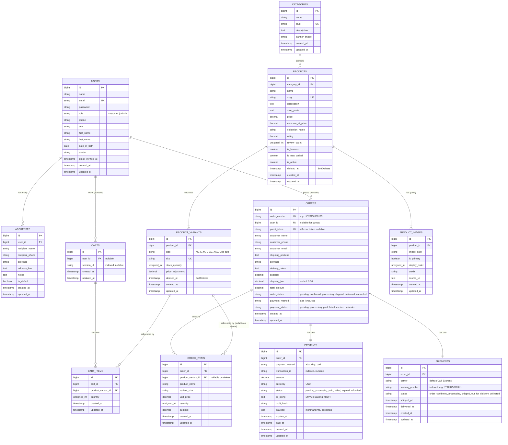

# HOYOS: Database Schema & Entity Architecture Specification

> **Database Type:** Relational (MySQL / SQLite compatible via Laravel Eloquent ORM)  
> **Source of Truth:** Laravel Migrations in [`database/migrations/`](file:///d:/Hoyos-project/database/migrations) and Models in [`app/Models/`](file:///d:/Hoyos-project/app/Models)  
> **Audit Status:** Verified against active migrations (read-only analysis; no database modifications)

---

## 1. Entity-Relationship Diagram (ERD)

---

## 2. Table-by-Table Specifications

### 2.1 `users`
Stores registered customer accounts and administrators.

| Column | Type | Nullable | Default | Constraints & Indexes | Description |
| :--- | :--- | :--- | :--- | :--- | :--- |
| `id` | `BIGINT UNSIGNED` | No | Auto-increment | Primary Key | User record identifier |
| `name` | `VARCHAR(255)` | No | — | — | Full display name |
| `email` | `VARCHAR(255)` | No | — | Unique Index | Account login email |
| `email_verified_at`| `TIMESTAMP` | Yes | `NULL` | — | Verification timestamp |
| `password` | `VARCHAR(255)` | No | — | — | Bcrypt-hashed password |
| `title` | `VARCHAR(255)` | Yes | `NULL` | — | Honorific / title preference |
| `first_name` | `VARCHAR(255)` | Yes | `NULL` | — | First name |
| `last_name` | `VARCHAR(255)` | Yes | `NULL` | — | Surname |
| `date_of_birth` | `DATE` | Yes | `NULL` | — | Customer birthday |
| `phone` | `VARCHAR(255)` | Yes | `NULL` | — | Phone contact number |
| `avatar` | `VARCHAR(255)` | Yes | `NULL` | — | Avatar image filepath |
| `role` | `VARCHAR(255)` | No | `'customer'` | — | Role flag: `'customer'` or `'admin'` |
| `remember_token` | `VARCHAR(100)` | Yes | `NULL` | — | Persistent session token |
| `created_at` | `TIMESTAMP` | Yes | `NULL` | — | Record creation timestamp |
| `updated_at` | `TIMESTAMP` | Yes | `NULL` | — | Last modification timestamp |

---

### 2.2 `addresses`
Saved delivery address book for registered customers.

| Column | Type | Nullable | Default | Constraints & Indexes | Description |
| :--- | :--- | :--- | :--- | :--- | :--- |
| `id` | `BIGINT UNSIGNED` | No | Auto-increment | Primary Key | Address identifier |
| `user_id` | `BIGINT UNSIGNED` | No | — | Foreign Key (`users.id`, Cascade Delete) | Owner account |
| `recipient_name` | `VARCHAR(255)` | No | — | — | Contact recipient name |
| `recipient_phone`| `VARCHAR(255)` | No | — | — | Delivery contact phone |
| `province` | `VARCHAR(255)` | No | — | — | Cambodian province / municipality |
| `address_line` | `TEXT` | No | — | — | Street number, commune, district |
| `notes` | `TEXT` | Yes | `NULL` | — | Dispatch/courier instructions |
| `is_default` | `BOOLEAN` | No | `false` | — | Default address flag for 1-click checkout |
| `created_at` | `TIMESTAMP` | Yes | `NULL` | — | Creation timestamp |
| `updated_at` | `TIMESTAMP` | Yes | `NULL` | — | Modification timestamp |

---

### 2.3 `categories`
Product aesthetic categorization (`Y2K`, `GOTH`, `STREETWEAR`).

| Column | Type | Nullable | Default | Constraints & Indexes | Description |
| :--- | :--- | :--- | :--- | :--- | :--- |
| `id` | `BIGINT UNSIGNED` | No | Auto-increment | Primary Key | Category identifier |
| `name` | `VARCHAR(255)` | No | — | — | Category display name |
| `slug` | `VARCHAR(255)` | No | — | Unique Index | URL slug (`y2k`, `goth`, `streetwear`) |
| `description` | `TEXT` | Yes | `NULL` | — | Aesthetic tagline & blurb |
| `banner_image` | `VARCHAR(255)` | Yes | `NULL` | — | Header background banner path |
| `created_at` | `TIMESTAMP` | Yes | `NULL` | — | Creation timestamp |
| `updated_at` | `TIMESTAMP` | Yes | `NULL` | — | Modification timestamp |

---

### 2.4 `products`
Apparel items catalog.

| Column | Type | Nullable | Default | Constraints & Indexes | Description |
| :--- | :--- | :--- | :--- | :--- | :--- |
| `id` | `BIGINT UNSIGNED` | No | Auto-increment | Primary Key | Product identifier |
| `category_id` | `BIGINT UNSIGNED` | No | — | Foreign Key (`categories.id`, Cascade Delete) | Primary style category |
| `name` | `VARCHAR(255)` | No | — | — | Product garment title |
| `slug` | `VARCHAR(255)` | No | — | Unique Index | URL slug identifier |
| `description` | `TEXT` | Yes | `NULL` | — | Long marketing copy & details |
| `size_guide` | `TEXT` | Yes | `NULL` | — | Sizing breakdown (kg & height) |
| `price` | `DECIMAL(10,2)`| No | — | — | Current selling price in USD |
| `compare_at_price`| `DECIMAL(10,2)`| Yes | `NULL` | — | Original strike-through price |
| `collection_name`| `VARCHAR(255)` | Yes | `NULL` | Index | Themed drop (*Neon Phantom Drift*, *Stone Guardian Core*) |
| `rating` | `DECIMAL(3,2)` | No | `5.00` | — | Cached review average rating |
| `review_count` | `INT UNSIGNED` | No | `5` | — | Cached total review count |
| `is_featured` | `BOOLEAN` | No | `false` | — | Featured catalog showcase flag |
| `is_new_arrival` | `BOOLEAN` | No | `false` | — | "NEW" badge toggle |
| `is_active` | `BOOLEAN` | No | `true` | — | Storefront visibility toggle |
| `deleted_at` | `TIMESTAMP` | Yes | `NULL` | SoftDeletes | Soft deletion timestamp |
| `created_at` | `TIMESTAMP` | Yes | `NULL` | — | Creation timestamp |
| `updated_at` | `TIMESTAMP` | Yes | `NULL` | — | Modification timestamp |

---

### 2.5 `product_variants`
Size options and inventory stock per product.

| Column | Type | Nullable | Default | Constraints & Indexes | Description |
| :--- | :--- | :--- | :--- | :--- | :--- |
| `id` | `BIGINT UNSIGNED` | No | Auto-increment | Primary Key | Variant identifier |
| `product_id` | `BIGINT UNSIGNED` | No | — | Foreign Key (`products.id`, Cascade Delete) | Parent product |
| `size` | `VARCHAR(255)` | No | — | — | Garment size: `XS`, `S`, `M`, `L`, `XL`, `XXL`, `One size` |
| `sku` | `VARCHAR(255)` | No | — | Unique Index | Stock Keeping Unit code |
| `stock_quantity` | `INT UNSIGNED` | No | `20` | — | Available inventory stock count |
| `price_adjustment`| `DECIMAL(10,2)`| No | `0.00` | — | Delta added to base product price |
| `deleted_at` | `TIMESTAMP` | Yes | `NULL` | SoftDeletes | Soft deletion timestamp |
| `created_at` | `TIMESTAMP` | Yes | `NULL` | — | Creation timestamp |
| `updated_at` | `TIMESTAMP` | Yes | `NULL` | — | Modification timestamp |

> **Unique Compound Constraint:** `UNIQUE (product_id, size)` prevents duplicate sizes per garment.

---

### 2.6 `product_images`
Product lookbook and gallery photographs.

| Column | Type | Nullable | Default | Constraints & Indexes | Description |
| :--- | :--- | :--- | :--- | :--- | :--- |
| `id` | `BIGINT UNSIGNED` | No | Auto-increment | Primary Key | Image identifier |
| `product_id` | `BIGINT UNSIGNED` | No | — | Foreign Key (`products.id`, Cascade Delete) | Parent product |
| `image_path` | `VARCHAR(255)` | No | — | — | Local public storage asset path |
| `is_primary` | `BOOLEAN` | No | `false` | — | Thumbnail card image flag |
| `display_order`| `INT UNSIGNED` | No | `0` | — | Ordering sequence in PDP gallery |
| `credit` | `VARCHAR(255)` | Yes | `NULL` | — | Photographer / brand attribution text |
| `source_url` | `TEXT` | Yes | `NULL` | — | External original source URL |
| `created_at` | `TIMESTAMP` | Yes | `NULL` | — | Creation timestamp |
| `updated_at` | `TIMESTAMP` | Yes | `NULL` | — | Modification timestamp |

---

### 2.7 `carts` & `cart_items`
Persistent shopping bags for both guests and authenticated customers.

#### `carts`
| Column | Type | Nullable | Default | Constraints & Indexes | Description |
| :--- | :--- | :--- | :--- | :--- | :--- |
| `id` | `BIGINT UNSIGNED` | No | Auto-increment | Primary Key | Cart identifier |
| `user_id` | `BIGINT UNSIGNED` | Yes | `NULL` | Foreign Key (`users.id`, Cascade Delete) | Associated user (nullable for guests) |
| `session_id` | `VARCHAR(255)` | Yes | `NULL` | Index | Guest browser session token |
| `created_at` | `TIMESTAMP` | Yes | `NULL` | — | Creation timestamp |
| `updated_at` | `TIMESTAMP` | Yes | `NULL` | — | Modification timestamp |

#### `cart_items`
| Column | Type | Nullable | Default | Constraints & Indexes | Description |
| :--- | :--- | :--- | :--- | :--- | :--- |
| `id` | `BIGINT UNSIGNED` | No | Auto-increment | Primary Key | Cart item identifier |
| `cart_id` | `BIGINT UNSIGNED` | No | — | Foreign Key (`carts.id`, Cascade Delete) | Parent cart |
| `product_variant_id`| `BIGINT UNSIGNED` | No | — | Foreign Key (`product_variants.id`, Cascade Delete) | Selected variant & size |
| `quantity` | `INT UNSIGNED` | No | `1` | — | Item count (1–10) |
| `created_at` | `TIMESTAMP` | Yes | `NULL` | — | Creation timestamp |
| `updated_at` | `TIMESTAMP` | Yes | `NULL` | — | Modification timestamp |

> **Unique Compound Constraint:** `UNIQUE (cart_id, product_variant_id)` guarantees one row per variant in a cart.

---

### 2.8 `orders` & `order_items`
Order records and purchased item snapshots.

#### `orders`
| Column | Type | Nullable | Default | Constraints & Indexes | Description |
| :--- | :--- | :--- | :--- | :--- | :--- |
| `id` | `BIGINT UNSIGNED` | No | Auto-increment | Primary Key | Order numeric identifier |
| `order_number` | `VARCHAR(255)` | No | — | Unique Index | Human-readable code (`HOYOS-000123`) |
| `user_id` | `BIGINT UNSIGNED` | Yes | `NULL` | Foreign Key (`users.id`, Null on Delete) | Customer account (null for guests) |
| `guest_token` | `VARCHAR(64)` | Yes | `NULL` | Unique Index | 40-char secret token for guest access |
| `customer_name` | `VARCHAR(255)` | No | — | — | Recipient full name |
| `customer_phone`| `VARCHAR(255)` | No | — | — | Cambodian phone number |
| `customer_email`| `VARCHAR(255)` | Yes | `NULL` | — | Contact email address |
| `shipping_address`| `TEXT` | No | — | — | Complete delivery street address |
| `province` | `VARCHAR(255)` | No | — | — | Province destination |
| `delivery_notes`| `TEXT` | Yes | `NULL` | — | Courier notes (e.g. "Call on arrival") |
| `subtotal` | `DECIMAL(10,2)`| No | — | — | Total item sum |
| `shipping_fee` | `DECIMAL(10,2)`| No | `0.00` | — | J&T delivery fee |
| `total_amount` | `DECIMAL(10,2)`| No | — | — | Grand total amount due |
| `order_status` | `VARCHAR(255)` | No | `'confirmed'`| Index | Fulfillment status |
| `payment_method`| `VARCHAR(255)` | No | — | Index | Payment rail: `aba_khqr` or `cod` |
| `payment_status`| `VARCHAR(255)` | No | `'pending'` | Index | Status: `pending`, `paid`, `failed`, `expired` |
| `created_at` | `TIMESTAMP` | Yes | `NULL` | — | Checkout creation timestamp |
| `updated_at` | `TIMESTAMP` | Yes | `NULL` | — | Modification timestamp |

#### `order_items`
| Column | Type | Nullable | Default | Constraints & Indexes | Description |
| :--- | :--- | :--- | :--- | :--- | :--- |
| `id` | `BIGINT UNSIGNED` | No | Auto-increment | Primary Key | Line item identifier |
| `order_id` | `BIGINT UNSIGNED` | No | — | Foreign Key (`orders.id`, Cascade Delete) | Parent order |
| `product_variant_id`| `BIGINT UNSIGNED` | Yes | `NULL` | Foreign Key (`product_variants.id`, Null on Delete) | Historical variant reference |
| `product_name` | `VARCHAR(255)` | No | — | — | Frozen snapshot of garment title |
| `variant_size` | `VARCHAR(255)` | No | — | — | Frozen size snapshot (`M`, `XL`, etc.) |
| `unit_price` | `DECIMAL(10,2)`| No | — | — | Frozen unit price at purchase time |
| `quantity` | `INT UNSIGNED` | No | — | — | Purchased unit quantity |
| `subtotal` | `DECIMAL(10,2)`| No | — | — | Line item subtotal (`unit_price * quantity`) |
| `created_at` | `TIMESTAMP` | Yes | `NULL` | — | Creation timestamp |
| `updated_at` | `TIMESTAMP` | Yes | `NULL` | — | Modification timestamp |

---

### 2.9 `payments`
ABA KHQR and Cash on Delivery transaction state records.

| Column | Type | Nullable | Default | Constraints & Indexes | Description |
| :--- | :--- | :--- | :--- | :--- | :--- |
| `id` | `BIGINT UNSIGNED` | No | Auto-increment | Primary Key | Payment record identifier |
| `order_id` | `BIGINT UNSIGNED` | No | — | Foreign Key (`orders.id`, Cascade Delete) | 1-to-1 link to order |
| `payment_method`| `VARCHAR(255)` | No | — | Index | Rail: `aba_khqr` or `cod` |
| `transaction_id`| `VARCHAR(255)` | Yes | `NULL` | Index | Internal or bank transaction code |
| `amount` | `DECIMAL(10,2)`| No | — | — | Payment sum in USD |
| `currency` | `VARCHAR(10)` | No | `'USD'` | — | Currency code |
| `status` | `VARCHAR(255)` | No | `'pending'` | Index | Status: `pending`, `paid`, `failed`, `expired` |
| `qr_string` | `TEXT` | Yes | `NULL` | — | Generated EMVCo Bakong KHQR payload |
| `md5_hash` | `VARCHAR(255)` | Yes | `NULL` | — | Signature/payload integrity hash |
| `payload` | `JSON` | Yes | `NULL` | — | Merchant details, deep-links, bank responses |
| `expires_at` | `TIMESTAMP` | Yes | `NULL` | — | Expiry time (5-minute countdown for KHQR) |
| `paid_at` | `TIMESTAMP` | Yes | `NULL` | — | Timestamp when payment was verified |
| `created_at` | `TIMESTAMP` | Yes | `NULL` | — | Creation timestamp |
| `updated_at` | `TIMESTAMP` | Yes | `NULL` | — | Modification timestamp |

---

### 2.10 `shipments`
Internal J&T Express carrier tracking and 5-stage fulfillment status.

| Column | Type | Nullable | Default | Constraints & Indexes | Description |
| :--- | :--- | :--- | :--- | :--- | :--- |
| `id` | `BIGINT UNSIGNED` | No | Auto-increment | Primary Key | Shipment record identifier |
| `order_id` | `BIGINT UNSIGNED` | No | — | Foreign Key (`orders.id`, Cascade Delete) | 1-to-1 link to order |
| `carrier` | `VARCHAR(255)` | No | `'J&T Express'` | — | Logistics carrier name |
| `tracking_number`| `VARCHAR(255)` | Yes | `NULL` | Index | J&T tracking code (e.g. `JT123456789KH`) |
| `status` | `VARCHAR(255)` | No | `'order_confirmed'`| Index | 5-stage status (see constants below) |
| `shipped_at` | `TIMESTAMP` | Yes | `NULL` | — | Timestamp when parcel was handed to J&T |
| `delivered_at`| `TIMESTAMP` | Yes | `NULL` | — | Timestamp of delivery completion |
| `created_at` | `TIMESTAMP` | Yes | `NULL` | — | Creation timestamp |
| `updated_at` | `TIMESTAMP` | Yes | `NULL` | — | Modification timestamp |

---

## 3. Infrastructure & Framework Tables

Generated by default Laravel 11 migrations:

| Table Name | Purpose | Key Columns |
| :--- | :--- | :--- |
| `password_reset_tokens` | Password reset tokens | `email` (PK), `token`, `created_at` |
| `sessions` | Database-backed HTTP session storage | `id` (PK), `user_id`, `ip_address`, `user_agent`, `payload`, `last_activity` |
| `cache` & `cache_locks` | Database cache driver storage | `key` (PK), `value`, `expiration` |
| `jobs` & `failed_jobs` | Background queue workers & failed jobs log | `id` (PK), `queue`, `payload`, `attempts`, `available_at`, `created_at` |

---

## 4. Business Constants & Allowed Enum Values

### 4.1 Shipment Statuses (`Shipment::STATUS_*`)
1. `order_confirmed` — Order placed and verified by Hoyos
2. `processing` — Clothing parcel packed and inspected
3. `shipped` — Parcel handed over to J&T Express counter
4. `out_for_delivery` — Courier currently delivering in target district
5. `delivered` — Successfully handed to recipient

### 4.2 Payment Statuses (`Payment::STATUS_*`)
- `pending` — Awaiting payment or scan
- `processing` — Payment processing in gateway
- `paid` — Confirmed and verified
- `failed` — Declined by bank
- `expired` — 5-minute KHQR timer reached zero without verification
- `refunded` — Refunded to buyer

### 4.3 Standard Apparel Sizes & Ordering Sequence
Sizes are sorted deterministically in models via `ProductVariant::sizeOrderIndex()`:
1. `XS` (Index 1)
2. `S` (Index 2)
3. `M` (Index 3)
4. `L` (Index 4)
5. `XL` (Index 5)
6. `XXL` (Index 6)
7. `One size` (Index 7)

---

## 5. Security & Access Control Model

1. **User Roles:**
   - `'customer'` (default): Allowed to view own orders, update personal profile, manage own addresses, and checkout.
   - `'admin'`: Checked via `$user->isAdmin()`. Allowed to view all orders and update shipment tracking codes and fulfillment statuses.
2. **Order Access Rule (`Order::canAccess(?User $user, ?string $token)`):**
   - Returns `true` if `$user->id === $order->user_id`.
   - Returns `true` if `$user->isAdmin()`.
   - Returns `true` if `$token` matches `$order->guest_token` via timing-safe `hash_equals()`.
   - Returns `false` otherwise (throws HTTP 403 Forbidden).
