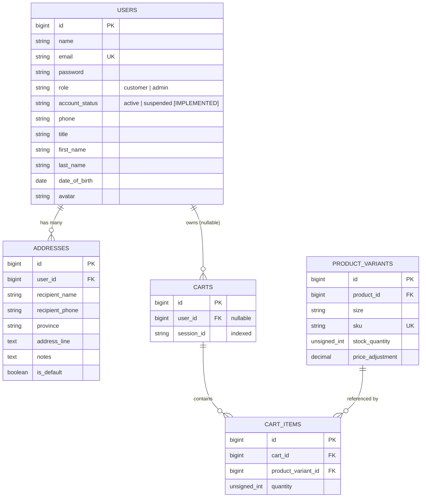
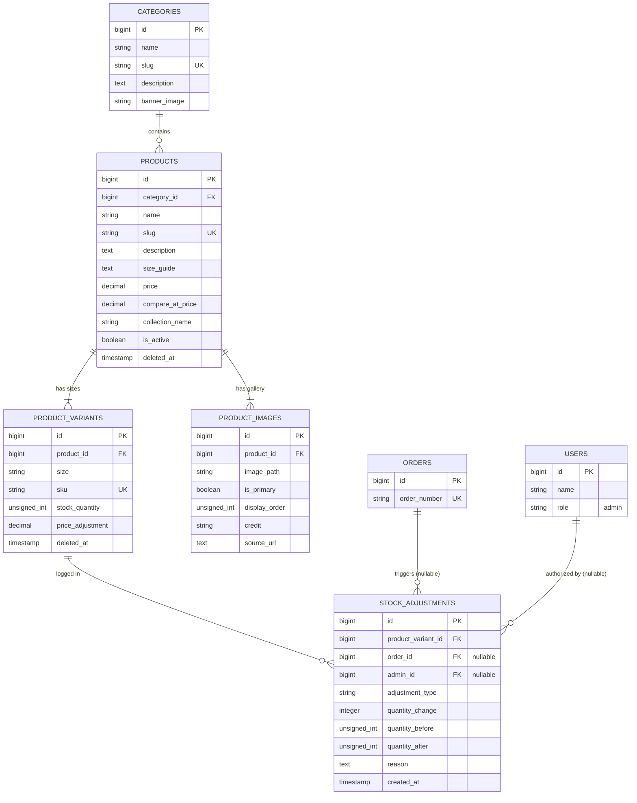
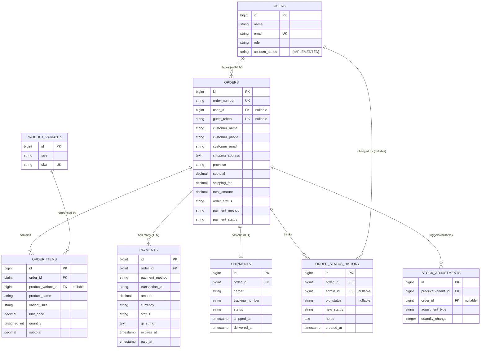
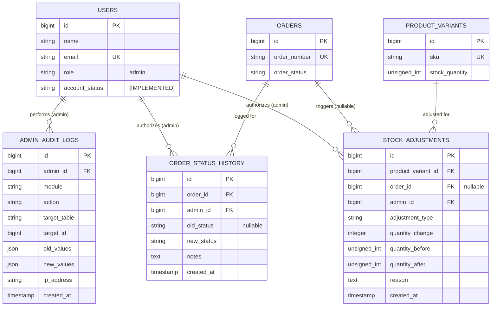

# HOYOS: Master Entity-Relationship Diagram & Database Specification (Final)

> **Database Engine:** PostgreSQL 16+ (Strict relational, ACID compliant)  
> **Source of Truth:** Laravel 11 Migrations (`database/migrations/`), Eloquent Models (`app/Models/`), and Agreed Architectural Design Decisions.  
> **Scope:** 15 Implemented Production Tables (all domain entities built and verified). Phase 2 modules (Loyalty, CMS Site Management, Pre-aggregated Report Snapshots) are excluded from the relational ERD and documented on the product roadmap. Framework infrastructure tables (`sessions`, `password_reset_tokens`, `cache`, `jobs`) are managed by Laravel and omitted from business ERD modeling.

---

## 1. Master Entity-Relationship Diagram (ERD)

This unified ERD covers the **15 implemented database tables** (12 core entities + 3 audit/ledger tables). Every table is explicitly marked as `[IMPLEMENTED]`.

```mermaid
erDiagram
    %% ==========================================
    %% CORE RELATIONSHIPS & CARDINALITIES
    %% ==========================================

    %% Customer & Account
    USERS ||--o{ ADDRESSES : "has many [IMPLEMENTED]"
    USERS ||--o{ ORDERS : "places (nullable) [IMPLEMENTED]"
    USERS ||--o{ CARTS : "owns (nullable) [IMPLEMENTED]"

    %% Catalog & Inventory
    CATEGORIES ||--o{ PRODUCTS : "contains [IMPLEMENTED]"
    PRODUCTS ||--|{ PRODUCT_VARIANTS : "has sizes [IMPLEMENTED]"
    PRODUCTS ||--|{ PRODUCT_IMAGES : "has gallery [IMPLEMENTED]"

    %% Cart & Session
    CARTS ||--o{ CART_ITEMS : "contains [IMPLEMENTED]"
    PRODUCT_VARIANTS ||--o{ CART_ITEMS : "referenced by [IMPLEMENTED]"

    %% Orders, Items & Fulfillment
    ORDERS ||--|{ ORDER_ITEMS : "contains [IMPLEMENTED]"
    PRODUCT_VARIANTS ||--o{ ORDER_ITEMS : "referenced by [IMPLEMENTED]"
    ORDERS ||--o{ PAYMENTS : "has many (1..N) [IMPLEMENTED]"
    ORDERS ||--o| SHIPMENTS : "has one (0..1) [IMPLEMENTED]"

    %% Tracking, Stock Ledger & Audit Logs
    ORDERS ||--o{ ORDER_STATUS_HISTORY : "tracks [IMPLEMENTED]"
    USERS ||--o{ ORDER_STATUS_HISTORY : "changed by (admin, nullable) [IMPLEMENTED]"

    PRODUCT_VARIANTS ||--o{ STOCK_ADJUSTMENTS : "logged in [IMPLEMENTED]"
    ORDERS ||--o{ STOCK_ADJUSTMENTS : "triggers (nullable) [IMPLEMENTED]"
    USERS ||--o{ STOCK_ADJUSTMENTS : "authorized by (admin, nullable) [IMPLEMENTED]"

    USERS ||--o{ ADMIN_AUDIT_LOGS : "performs (admin) [IMPLEMENTED]"

    %% ==========================================
    %% ENTITY DEFINITIONS & SCHEMAS
    %% ==========================================

    USERS {
        bigint id PK
        string name "User full name"
        string email UK "Unique email address"
        timestamp email_verified_at "Nullable"
        string password "Hashed password"
        string title "Nullable (Mr, Ms, Prefer not to say)"
        string first_name "Nullable"
        string last_name "Nullable"
        date date_of_birth "Nullable"
        string phone "Nullable"
        string avatar "Nullable image path"
        string role "customer | admin (default: customer)"
        string account_status "active | suspended (default: active) [IMPLEMENTED]"
        string remember_token "Nullable"
        timestamp created_at
        timestamp updated_at
    }

    ADDRESSES {
        bigint id PK
        bigint user_id FK "Cascade on delete"
        string recipient_name "Contact person"
        string recipient_phone "Phone number (+855...)"
        string province "Cambodian province/city"
        text address_line "Street / House number"
        text notes "Nullable delivery instructions"
        boolean is_default "Default delivery address flag"
        timestamp created_at
        timestamp updated_at
    }

    CATEGORIES {
        bigint id PK
        string name "Category display name"
        string slug UK "URL identifier (y2k, goth, streetwear)"
        text description "Nullable category description"
        string banner_image "Nullable banner asset path"
        timestamp created_at
        timestamp updated_at
    }

    PRODUCTS {
        bigint id PK
        bigint category_id FK "Cascade on delete"
        string name "Product title"
        string slug UK "Unique SEO slug"
        text description "Nullable detailed description"
        text size_guide "Nullable sizing text/measurements"
        decimal price "Base price (10,2) in USD"
        decimal compare_at_price "Nullable original/strikethrough price"
        string collection_name "Indexed nullable collection (Y2K, GOTH)"
        decimal rating "Aggregated rating (3,2, default 5.00)"
        unsigned_int review_count "Static count (default 5)"
        boolean is_featured "Featured highlight flag"
        boolean is_new_arrival "New arrival badge flag"
        boolean is_active "Storefront visibility flag"
        timestamp deleted_at "SoftDeletes timestamp"
        timestamp created_at
        timestamp updated_at
    }

    PRODUCT_VARIANTS {
        bigint id PK
        bigint product_id FK "Cascade on delete"
        string size "Apparel size (XS, S, M, L, XL, XXL, One size)"
        string sku UK "Unique Stock Keeping Unit"
        unsigned_int stock_quantity "Available inventory (CHECK >= 0 [IMPLEMENTED])"
        decimal price_adjustment "Size premium/discount (10,2)"
        timestamp deleted_at "SoftDeletes timestamp"
        timestamp created_at
        timestamp updated_at
    }

    PRODUCT_IMAGES {
        bigint id PK
        bigint product_id FK "Cascade on delete"
        string image_path "Storage relative file path"
        boolean is_primary "Hero card image flag"
        unsigned_int display_order "Sorting order in gallery"
        string credit "Nullable creator/brand credit"
        text source_url "Nullable reference URL"
        timestamp created_at
        timestamp updated_at
    }

    CARTS {
        bigint id PK
        bigint user_id FK "Nullable, cascade on delete"
        string session_id "Indexed guest session identifier"
        timestamp created_at
        timestamp updated_at
    }

    CART_ITEMS {
        bigint id PK
        bigint cart_id FK "Cascade on delete"
        bigint product_variant_id FK "Cascade on delete"
        unsigned_int quantity "Quantity ordered (min 1)"
        timestamp created_at
        timestamp updated_at
    }

    ORDERS {
        bigint id PK
        string order_number UK "Indexed unique number (HOYOS-XXXXXX)"
        bigint user_id FK "Nullable for guests (Set NULL on delete)"
        string guest_token UK "Nullable 40-char secret token"
        string customer_name "Snapshot recipient name"
        string customer_phone "Snapshot phone number"
        string customer_email "Nullable snapshot email"
        text shipping_address "Snapshot street address"
        string province "Snapshot province/city"
        text delivery_notes "Nullable instructions for rider"
        decimal subtotal "Items subtotal (10,2) in USD"
        decimal shipping_fee "Shipping fee (10,2, default 0.00)"
        decimal total_amount "Order total (10,2) in USD"
        string order_status "confirmed, processing, shipped, delivered, cancelled"
        string payment_method "aba_khqr, cod"
        string payment_status "pending, processing, paid, failed, expired, refunded, cancelled [IMPLEMENTED]"
        timestamp created_at
        timestamp updated_at
    }

    ORDER_ITEMS {
        bigint id PK
        bigint order_id FK "Restrict on delete [IMPLEMENTED]"
        bigint product_variant_id FK "Nullable (Set NULL on variant delete)"
        string product_name "Snapshot product name"
        string variant_size "Snapshot apparel size"
        decimal unit_price "Snapshot unit price (10,2)"
        unsigned_int quantity "Units purchased"
        decimal subtotal "Line total (10,2) in USD"
        timestamp created_at
        timestamp updated_at
    }

    PAYMENTS {
        bigint id PK
        bigint order_id FK "Restrict on delete [IMPLEMENTED]"
        string payment_method "aba_khqr, cod"
        string transaction_id "Indexed nullable gateway transaction reference"
        decimal amount "Charged amount (10,2) in USD"
        string currency "USD (default: USD)"
        string status "pending, processing, paid, failed, expired, refunded, cancelled [IMPLEMENTED]"
        text qr_string "EMVCo Bakong KHQR dynamic string"
        string md5_hash "Nullable signature hash"
        json payload "Nullable gateway metadata & deep links"
        timestamp expires_at "Nullable 5-minute timeout timestamp"
        timestamp paid_at "Nullable verification timestamp"
        timestamp created_at
        timestamp updated_at
    }

    SHIPMENTS {
        bigint id PK
        bigint order_id FK "Restrict on delete [IMPLEMENTED]"
        string carrier "Default: J&T Express"
        string tracking_number "Indexed nullable J&T tracking code"
        string status "order_confirmed, processing, shipped, out_for_delivery, delivered, cancelled [IMPLEMENTED]"
        timestamp shipped_at "Nullable dispatch timestamp"
        timestamp delivered_at "Nullable final delivery timestamp"
        timestamp created_at
        timestamp updated_at
    }

    ORDER_STATUS_HISTORY {
        bigint id PK
        bigint order_id FK "Restrict on delete"
        bigint admin_id FK "Nullable (Set NULL on admin delete)"
        string old_status "Nullable (NULL on initial creation)"
        string new_status "Transitioned order_status value"
        text notes "Nullable internal transition remark"
        timestamp created_at "Transition timestamp"
    }

    STOCK_ADJUSTMENTS {
        bigint id PK
        bigint product_variant_id FK "Restrict on delete"
        bigint order_id FK "Nullable, restrict on delete (Indexed with type)"
        bigint admin_id FK "Nullable for system actions (Set NULL)"
        string adjustment_type "order_reserved, order_cancelled, payment_expired, manual_restock, manual_shrinkage, damage"
        integer quantity_change "Signed inventory delta (+/-)"
        unsigned_int quantity_before "Inventory count before adjustment"
        unsigned_int quantity_after "Inventory count after adjustment"
        text reason "Explanation or order_number reference"
        timestamp created_at "Adjustment timestamp"
    }

    ADMIN_AUDIT_LOGS {
        bigint id PK
        bigint admin_id FK "Nullable (Set NULL on user delete)"
        string module "orders, payments, shipments, products, inventory, users"
        string action "create, update, cancel, refund, restock, status_change"
        string target_table "orders, product_variants, shipments, users"
        bigint target_id "Primary key of altered record"
        json old_values "Nullable JSON snapshot before mutation"
        json new_values "Nullable JSON snapshot after mutation"
        string ip_address "Nullable IPv4/IPv6 client IP"
        timestamp created_at "Audit event timestamp"
    }
```



---

## 2. Table-by-Table Column Specifications (Audit and Ledger Tables)

The following three tables provide enterprise-grade auditability, idempotent inventory restoration, and full lifecycle tracking. All timestamps use standard PostgreSQL `TIMESTAMP` (`timestamp without time zone`), matching Laravel's default `$table->timestamps()` convention.

### 2.1 `order_status_history` [IMPLEMENTED]
Tracks every transition of `orders.order_status` from creation through delivery or cancellation.
- **Engine:** PostgreSQL
- **Foreign Key Rules:**
  - `order_id`: References `orders(id)` with `ON DELETE RESTRICT` (orders cannot be deleted while history exists).
  - `admin_id`: References `users(id)` with `ON DELETE SET NULL` (nullable for automated system transitions such as automated expiry).

| Column Name | PostgreSQL Data Type | Nullable | Default | Constraints & Indexes | Description |
| :--- | :--- | :--- | :--- | :--- | :--- |
| `id` | `BIGSERIAL` / `BIGINT GENERATED ALWAYS AS IDENTITY` | No | Auto | Primary Key | Audit log row ID |
| `order_id` | `BIGINT` | No | — | FK (`orders.id`), Index | Targeted order |
| `admin_id` | `BIGINT` | Yes | `NULL` | FK (`users.id`), Index | Staff user who triggered change (`NULL` = system auto-action) |
| `old_status` | `VARCHAR(50)` | **Yes** | `NULL` | — | Status before transition (**`NULL` on initial creation**) |
| `new_status` | `VARCHAR(50)` | No | — | Index | Status after transition |
| `notes` | `TEXT` | Yes | `NULL` | — | Internal reason (e.g. "Customer requested cancellation" or "Grace period elapsed") |
| `created_at` | `TIMESTAMP` | No | `CURRENT_TIMESTAMP` | Index | Exact timestamp of change |

---

### 2.2 `stock_adjustments` [IMPLEMENTED]
Maintains an immutable ledger of all stock quantity movements (decrements at checkout, restorations upon expiry or cancellation, manual warehouse restocks, or damaged items).
- **Engine:** PostgreSQL
- **Foreign Key Rules:**
  - `product_variant_id`: References `product_variants(id)` with `ON DELETE RESTRICT` (prevents deleting active inventory variants without audit trail).
  - `order_id`: References `orders(id)` with `ON DELETE RESTRICT` (links adjustment to a specific customer order).
  - `admin_id`: References `users(id)` with `ON DELETE SET NULL` (`NULL` represents automated actions triggered by checkout or payment expiry).
- **Idempotency Index:** A composite index on `(order_id, adjustment_type)` allows the application to check whether inventory has already been restored for an expired or cancelled order, preventing duplicate stock increments.

| Column Name | PostgreSQL Data Type | Nullable | Default | Constraints & Indexes | Description |
| :--- | :--- | :--- | :--- | :--- | :--- |
| `id` | `BIGSERIAL` | No | Auto | Primary Key | Ledger sequence ID |
| `product_variant_id` | `BIGINT` | No | — | FK (`product_variants.id`), Index | Specific size variant adjusted |
| `order_id` | `BIGINT` | **Yes** | `NULL` | FK (`orders.id`), **Index `(order_id, adjustment_type)`** | Linked order (null for manual warehouse restocks) |
| `admin_id` | `BIGINT` | Yes | `NULL` | FK (`users.id`), Index | Authorizing admin (`NULL` = system automated) |
| `adjustment_type` | `VARCHAR(50)` | No | — | Index | `order_reserved`, `order_cancelled`, `payment_expired`, `manual_restock`, `manual_shrinkage`, `damage` |
| `quantity_change` | `INTEGER` | No | — | — | Signed integer: negative for deduction (`-1`), positive for restore/restock (`+1`) |
| `quantity_before` | `INTEGER` | No | — | `CHECK (quantity_before >= 0)` | Variant stock level prior to change |
| `quantity_after` | `INTEGER` | No | — | `CHECK (quantity_after >= 0)` | Variant stock level post change |
| `reason` | `TEXT` | No | — | — | Reference string (e.g. `Order #HOYOS-000124 Reserved` or `PO-2026-10-01`) |
| `created_at` | `TIMESTAMP` | No | `CURRENT_TIMESTAMP` | Index | Audit timestamp |

---

### 2.3 `admin_audit_logs` [IMPLEMENTED]
Security and administrative governance log capturing all mutations performed in the `/admin` backoffice.
- **Engine:** PostgreSQL
- **Foreign Key Rules:**
  - `admin_id`: References `users(id)` with `ON DELETE SET NULL`.

| Column Name | PostgreSQL Data Type | Nullable | Default | Constraints & Indexes | Description |
| :--- | :--- | :--- | :--- | :--- | :--- |
| `id` | `BIGSERIAL` | No | Auto | Primary Key | Audit entry identifier |
| `admin_id` | `BIGINT` | Yes | `NULL` | FK (`users.id`), Index | Admin performing the action |
| `module` | `VARCHAR(50)` | No | — | Index | Module name (`orders`, `shipments`, `products`, `users`, `reports`) |
| `action` | `VARCHAR(50)` | No | — | Index | Action verb (`create`, `update`, `cancel`, `refund`, `export`) |
| `target_table` | `VARCHAR(100)` | No | — | — | Database table affected (`orders`, `shipments`, `products`) |
| `target_id` | `BIGINT` | Yes | `NULL` | Index | Primary key of modified row |
| `old_values` | `JSONB` | Yes | `NULL` | — | Snapshot before mutation |
| `new_values` | `JSONB` | Yes | `NULL` | — | Snapshot after mutation |
| `ip_address` | `VARCHAR(45)` | Yes | `NULL` | — | Admin client IP address |
| `created_at` | `TIMESTAMP` | No | `CURRENT_TIMESTAMP` | Index | Event execution timestamp |

---

## 3. Status Values, Status Mapping & Gateway Scope

### 3.1 `orders.order_status`
Defined in `2026_09_27_143315_create_orders_and_order_items_table.php`, `Order.php`, and `ShipmentService.php`:
- `confirmed` *(Default on creation in `CreateOrderAction`)*: Order recorded, items reserved, ready for warehouse packing.
- `processing`: Order parcel assembled and packaged at Hoyos fulfillment station.
- `shipped`: Handed over to J&T Express counter; stamped exclusively via the Shipments screen.
- `delivered`: Successfully handed to recipient; stamped exclusively via the Shipments screen.
- `cancelled`: Cancelled by administrator or by system auto-cancellation (after the 15-minute grace period); triggers stock restoration.

> **CRITICAL RULE:** `orders.order_status` contains **NO** `out_for_delivery` status. When a shipment is `out_for_delivery`, `orders.order_status` remains `shipped`.

---

### 3.2 `shipments.status` & Mapping to `orders.order_status`

The codebase separates logistics stages (`shipments.status`) from high-level commercial order state (`orders.order_status`). The following table defines the exact relationship between the two tables:

| `shipments.status` | Corresponding `orders.order_status` | Status Lifecycle Stage | Automated Triggers & Actions in Code |
| :--- | :--- | :--- | :--- |
| `order_confirmed` [EXISTS] | `confirmed` | 1. Order Placed | Initial state initialized by `CreateOrderAction`. Parcel awaiting fulfillment queue. |
| `processing` [EXISTS] | `processing` | 2. Packing | Admin moves order to `processing` on the Orders screen when packing begins. |
| `shipped` [EXISTS] | `shipped` | 3. Handed to Courier | Set via Shipments screen. `ShipmentService` sets `shipment.shipped_at = now()` and syncs `order.order_status = 'shipped'`. |
| **`out_for_delivery`** [EXISTS] | **`shipped`** | 4. Courier in Transit | Set via Shipments screen. **`order.order_status` remains `'shipped'`** (does not mutate). |
| `delivered` [EXISTS] | `delivered` | 5. Delivery Complete | Set via Shipments screen. `ShipmentService` sets `shipment.delivered_at = now()` and syncs `order.order_status = 'delivered'`. |
| **`cancelled`** [IMPLEMENTED] | **`cancelled`** | Cancelled / Voided | Set when an order is cancelled by admin or system expiry. Parcel is marked cancelled and never dispatched. |

---

### 3.3 `orders.payment_status` & `payments.status`
- `pending` *(Default)*: Awaiting payment verification (both for initial KHQR and COD prior to physical delivery).
- `processing`: Gateway verification in flight.
- `paid`: Payment verified by KHQR simulator/webhook or COD delivery collection.
- `failed`: Transaction failed at gateway.
- `expired`: 5-minute KHQR window elapsed without customer payment.
- `refunded`: Off-platform manual refund issued by management and recorded by admin.
- `cancelled` [IMPLEMENTED]: Applied when an order is cancelled prior to payment collection (e.g. cancelled COD order).

> **Payment Gateway Scope Note:**  
> The existing `payments` table columns remain identical and ready for the future live ABA PayWay / National Bakong integration. In the current phase, QR strings and transactions are synthesized locally (`AbaPaymentService.php`) and verified via polling/simulation. When live API credentials are connected in Phase 2, the production gateway will populate:
> - `transaction_id`: Official ABA PayWay / Bakong transaction hash.
> - `md5_hash`: Gateway cryptographic signature verification hash (proposed, confirm against ABA PayWay docs).
> - `payload`: Full JSON response payload received from the ABA server-to-server webhook callback (proposed, confirm against ABA PayWay docs).
> - `paid_at`: Gateway server verified timestamp.
> - Cash on Delivery (COD) operates 100% independently of any gateway.

---

## 4. Database Integrity Constraints & Rules

### 4.1 Unique Constraints (UK)
1. `users.email` — Unique customer/admin login email.
2. `categories.slug` — Unique category URL slug.
3. `products.slug` — Unique product URL identifier.
4. `product_variants.sku` — Unique warehouse SKU string.
5. Compound `(product_id, size)` on `product_variants` — Prevents duplicate sizes for the same product.
6. Compound `(cart_id, product_variant_id)` on `cart_items` — Prevents duplicate rows for the same variant in a cart.
7. `orders.order_number` — Unique human-readable identifier (e.g. `HOYOS-000001`).
8. `orders.guest_token` — Unique cryptographically secure 40-character guest authorization token (nullable).
9. Compound `(order_id, adjustment_type)` on `stock_adjustments` — Enforces single restoration per order `[IMPLEMENTED]`.
10. `shipments.order_id` — Enforces strict 1:0..1 relationship `[IMPLEMENTED]`.

### 4.2 Financial Precision (`DECIMAL(10, 2)`)
To avoid floating-point rounding errors, all monetary amounts are strictly `NUMERIC(10, 2)` / `DECIMAL(10, 2)`:
- `products.price`, `products.compare_at_price`, `product_variants.price_adjustment`
- `orders.subtotal`, `orders.shipping_fee`, `orders.total_amount`
- `order_items.unit_price`, `order_items.subtotal`, `payments.amount`

### 4.3 Inventory Integrity & PostgreSQL Unsigned Integer Behavior
- **PostgreSQL Native Behavior:** In `2026_09_27_143312_create_product_variants_table.php`, `$table->unsignedInteger('stock_quantity')` is executed. In PostgreSQL, **there is no unsigned integer type**. Laravel maps `unsignedInteger` to standard signed 32-bit `integer` without adding a check constraint.
- **Race Condition Vulnerability:** If two customers checkout simultaneously for the last item, application-level checks (`if ($stock < $qty)`) can both pass before decrementing, driving `stock_quantity` into negative values (`-1`).
- **Required Safeguards:**
  1. Add database-level constraint `CHECK (stock_quantity >= 0)` as `[IMPLEMENTED]`.
  2. Implement atomic stock deductions in `CreateOrderAction`:
     ```sql
     UPDATE product_variants 
     SET stock_quantity = stock_quantity - ? 
     WHERE id = ? AND stock_quantity >= ?;
     ```
     or execute inside a transaction using `ProductVariant::where('id', $id)->lockForUpdate()->first()`.

### 4.4 Foreign Key Deletion Rules (Current vs. Planned Production)

| Relationship | Foreign Key Column | Target Table | Current Migration Rule | Planned Production Rule | Justification |
| :--- | :--- | :--- | :--- | :--- | :--- |
| `order_items` ➔ `orders` | `order_id` | `orders(id)` | **`RESTRICT`** `[IMPLEMENTED]` | **`RESTRICT`** | Financial invoice line items must never be dropped if an order record exists. |
| `payments` ➔ `orders` | `order_id` | `orders(id)` | **`RESTRICT`** `[IMPLEMENTED]` | **`RESTRICT`** | Financial payment audit trail must be strictly preserved; hard-deleting orders is prohibited. |
| `shipments` ➔ `orders` | `order_id` | `orders(id)` | **`RESTRICT`** `[IMPLEMENTED]` | **`RESTRICT`** | Courier logistics tracking records must be permanently retained for carrier dispute resolution. |
| `order_status_history` ➔ `orders` | `order_id` | `orders(id)` | **`RESTRICT`** `[IMPLEMENTED]` | **`RESTRICT`** | State transition log must never be orphaned or deleted. |
| `order_status_history` ➔ `users` | `admin_id` | `users(id)` | **`SET NULL`** `[IMPLEMENTED]` | **`SET NULL`** | If an admin user account is deleted, the history row remains intact with `admin_id = NULL`. |
| `stock_adjustments` ➔ `product_variants` | `product_variant_id` | `product_variants(id)` | **`RESTRICT`** `[IMPLEMENTED]` | **`RESTRICT`** | Inventory ledger rows cannot be deleted; variants with history cannot be dropped. |
| `stock_adjustments` ➔ `orders` | `order_id` | `orders(id)` | **`RESTRICT`** `[IMPLEMENTED]` | **`RESTRICT`** | Inventory ledger rows cannot be orphaned; orders with adjustment history cannot be deleted. |
| `stock_adjustments` ➔ `users` | `admin_id` | `users(id)` | **`SET NULL`** `[IMPLEMENTED]` | **`SET NULL`** | Preserves inventory audit trail when staff accounts change. |
| `admin_audit_logs` ➔ `users` | `admin_id` | `users(id)` | **`SET NULL`** `[IMPLEMENTED]` | **`SET NULL`** | Security audit history must persist permanently. |
| `orders` ➔ `users` | `user_id` | `users(id)` | `SET NULL` | **`SET NULL`** | Preserved. Deleting a customer account preserves their past orders for sales reporting. |
| `order_items` ➔ `product_variants` | `product_variant_id` | `product_variants(id)` | `SET NULL` | **`SET NULL`** | Preserved. Snapshot columns (`product_name`, `unit_price`) ensure line items survive variant deletion. |
| `addresses` ➔ `users` | `user_id` | `users(id)` | `CASCADE` | **`CASCADE`** | Personal address book entries are purged upon user account deletion. |
| `carts` ➔ `users` | `user_id` | `users(id)` | `CASCADE` | **`CASCADE`** | Ephemeral shopping sessions are deleted upon user deletion. |
| `cart_items` ➔ `carts` | `cart_id` | `carts(id)` | `CASCADE` | **`CASCADE`** | Items are purged when the parent cart is destroyed. |
| `cart_items` ➔ `product_variants` | `product_variant_id` | `product_variants(id)` | `CASCADE` | **`CASCADE`** | Dropping an unpublished variant removes it from active carts. |
| `products` ➔ `categories` | `category_id` | `categories(id)` | `CASCADE` | **`RESTRICT`** | Planned (Phase 2): Prevents accidental deletion of a category that still contains active products. |
| `product_variants` ➔ `products` | `product_id` | `products(id)` | `CASCADE` | **`CASCADE`** | Soft deletes (`deleted_at`) protect catalog items in practice. |
| `product_images` ➔ `products` | `product_id` | `products(id)` | `CASCADE` | **`CASCADE`** | Product photo gallery entries are tied to the parent product. |

---

## 5. Module Zoom-in Diagrams

These four focused diagrams reuse the exact table and column names from the master ERD, allowing the design team to inspect individual sub-systems independently.

### 5.1 Zoom-in 1: Customer & Cart Module



---

### 5.2 Zoom-in 2: Product & Stock Module



---

### 5.3 Zoom-in 3: Order, Payment & Shipment Module



---

### 5.4 Zoom-in 4: Admin & Governance Audit Module



---

## 6. What is Implemented vs Phase 2

| Domain / Feature | Status | Details |
| :--- | :--- | :--- |
| **Catalog & Products** | **Implemented** | Categories, products, variants, image galleries, search, filtering, and admin CRUD (`/admin/products`). |
| **Inventory Management** | **Implemented** | Variant stock quantities, restock/audit adjustments (`/admin/inventory`), `CHECK (stock_quantity >= 0)` constraint, pessimistic locking (`lockForUpdate`), atomic stock deductions (`WHERE stock_quantity >= qty`). |
| **Cart & Guest Checkout** | **Implemented** | Session carts, guest token authentication, account registration, multi-item checkout with address persistence. |
| **Order Lifecycle State Machine** | **Implemented** | Full state transition: `confirmed` ➔ `processing` ➔ `shipped` ➔ `delivered` / `cancelled`. Order status history logging (`order_status_history`). |
| **Logistics & Shipments** | **Implemented** | Courier tracking, dispatch updates, 1:0..1 unique relationship on `shipments.order_id`, cancellation support (`shipments.status = 'cancelled'`). Public rate-limited tracking (`/track-order`). |
| **Payment Simulation & QR** | **Implemented** | Dynamic KHQR string generation, 5-minute QR validity, 15-minute payment grace period, payment simulation endpoints (guarded to non-production), scheduled unpaid order expiry (`ExpireUnpaidOrdersCommand`). |
| **Foreign Key Protection** | **Implemented** | `order_items`, `payments`, and `shipments` FKs to `orders(id)` configured with `ON DELETE RESTRICT`. |
| **Admin Governance & Auditing** | **Implemented** | Dedicated `admin` role gate (`EnsureUserIsAdmin`), immutable security audit logging (`admin_audit_logs`), read-only audit log browser (`/admin/audit-logs`). |
| **Customer Management** | **Implemented** | Customer directory with spend analytics and account status toggle (`active`/`suspended`) (`/admin/customers`). Suspended users blocked at login. |
| **Live Reports & Analytics** | **Implemented** | Live SQL aggregation dashboard & reports (`/admin`, `/admin/reports`), PostgreSQL timezone-safe grouping (`DateBucketHelper`), low-stock alerts, CSV exports. |
| **Loyalty & Rewards Program** | **Phase 2 (Deferred)** | Tiered points accumulation, points redemption at checkout, milestone perks. *(Not implemented in current codebase).* |
| **Content Management System (CMS)** | **Phase 2 (Deferred)** | Visual marketing banner editor, blog/editorial engine, policy page CMS. *(Not implemented in current codebase).* |
| **Live ABA PayWay / Bakong Gateway** | **Phase 2 (Deferred)** | Official bank API integration, webhook cryptographic signature verification (HMAC/MD5), merchant production credentials. *(Currently running secure local simulation).* |
| **Automated Gateway Refunds** | **Phase 2 (Deferred)** | API-driven automated card/bank account reversal. *(Currently implemented as off-platform manual refund recording with audit trail).* |
| **Categories ON DELETE RESTRICT** | **Phase 2 (Deferred)** | Changing `products.category_id` FK from `CASCADE` to `RESTRICT` deferred to avoid altering existing production foreign keys until catalog policy is finalized. |

