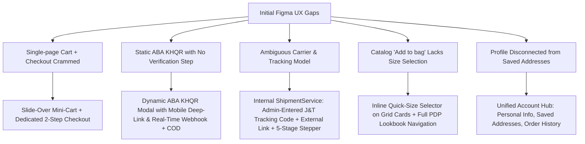
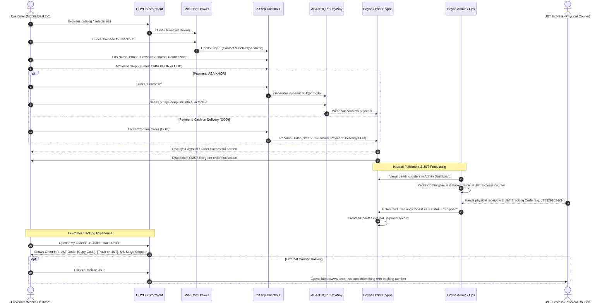
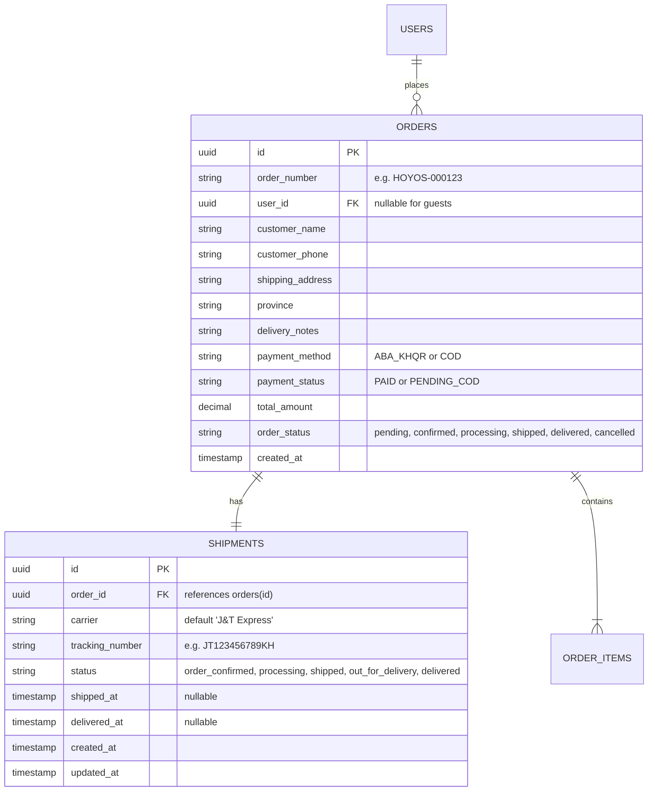
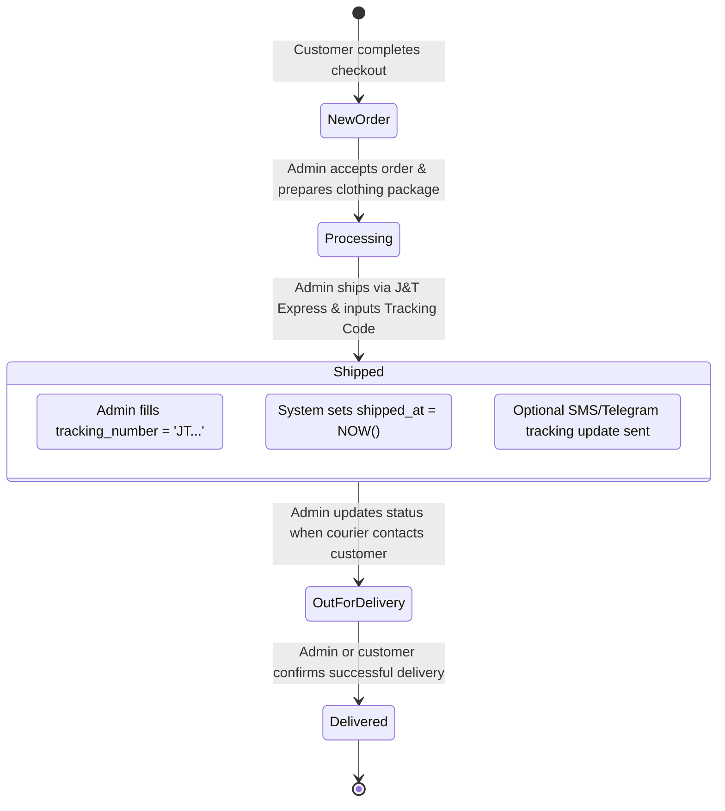
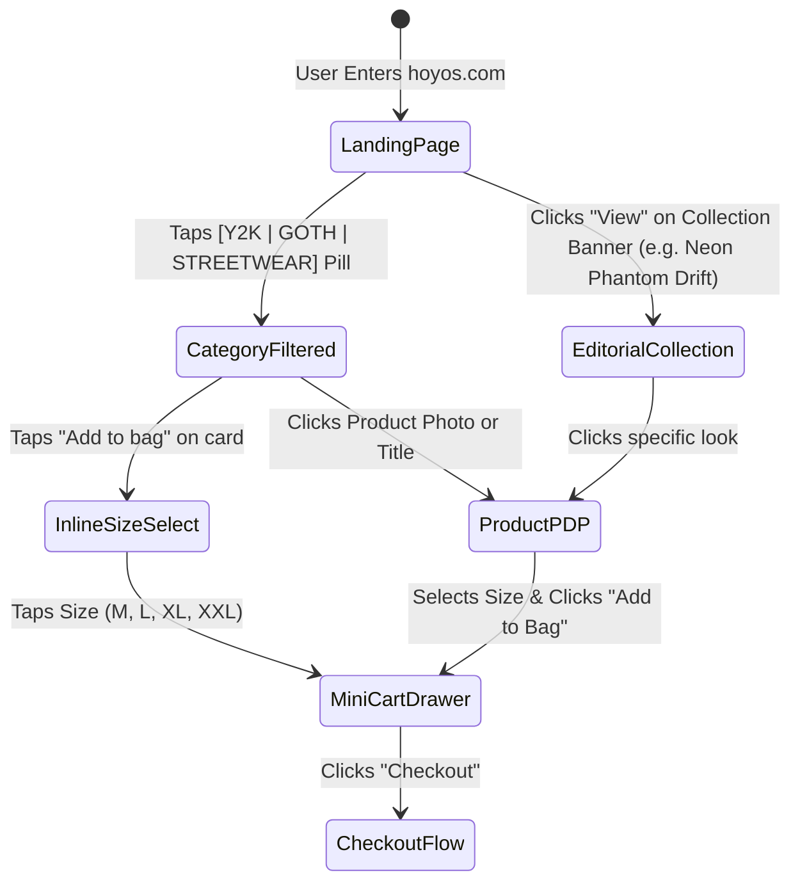
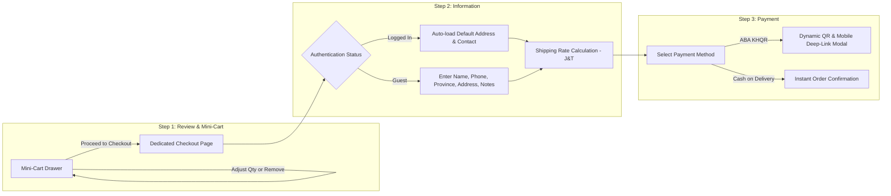
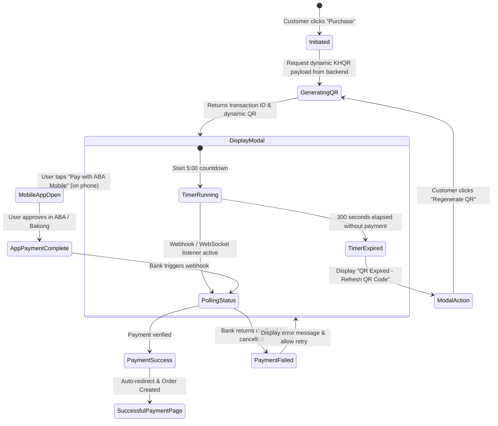

# HOYOS: User Flow Specification & UX Architecture Blueprint

> **Brand Identity:** HOYOS — Gen Z Streetwear, Y2K Dark Aesthetic, Goth & Cyberpunk-infused Fashion  
> **Market Context:** Cambodia (Phnom Penh & Provinces)  
> **Core Payment Standard:** ABA KHQR (Bakong National Payment System) & Cash on Delivery (COD)  
> **Fulfillment Carrier:** J&T Express Cambodia *(External Carrier — No direct API integration; Admin-managed tracking code & internal status)*  
> **Design Assets Source:** [`d:/Hoyos-project/Figma-Design`](file:///d:/Hoyos-project/Figma-Design)

---

## 1. Executive Summary & Design System Inventory

HOYOS bridges vintage Y2K rebellion, dark gothic silhouettes, and futuristic cyberpunk elements into an edgy e-commerce platform. Based on the 26 screen designs provided in [`Figma-Design`](file:///d:/Hoyos-project/Figma-Design), this document establishes the full user flow, incorporates architectural decisions reached via `/grill-me`, and formalizes the **internal shipping and order tracking model** using J&T Express as an external carrier.

### 1.1 Core Fulfillment Architecture Directive

> [!IMPORTANT]
> **No Direct J&T API Integration:**  
> Hoyos will **NOT** integrate directly with the J&T Express API (no API auth, no automated telemetry sync, no carrier webhooks). J&T Express is strictly an external courier. Hoyos uses an internal `ShipmentService` and `shipments` data model where:
> 1. When an order is shipped via J&T Express, the Hoyos Admin enters the customer's J&T tracking code into Hoyos.
> 2. Hoyos associates the tracking code and updates the internal status (`Order Confirmed` -> `Processing` -> `Shipped` -> `Out for Delivery` -> `Delivered`).
> 3. Customers view their tracking code inside *My Orders*, can 1-click **Copy Tracking Number**, view the internal status stepper, and click **Track on J&T** to open the external J&T tracking portal.

### 1.2 Screen Design Mapping Matrix

| Design Area | Figma Screen File | Key Elements & Functional Role |
| :--- | :--- | :--- |
| **Discovery & Home** | [`Landing page.png`](file:///d:/Hoyos-project/Figma-Design/Landing%20page.png) | 3D Chrome logo, Hero CTA, Lookbook carousel, Collection editorial showcases (*Neon Phantom Drift*, *Stone Guardian Core*), Catalog grid |
| **Collections & Lookbook** | [`View detail collection page1.png`](file:///d:/Hoyos-project/Figma-Design/View%20detail%20collection%20page1.png)<br>[`View detail collection page2.png`](file:///d:/Hoyos-project/Figma-Design/View%20detail%20collection%20page2.png) | Curated style edit, lookbook story cards, product grid with live price & fast add-to-bag |
| **Category Browsing** | [`Goth page.png`](file:///d:/Hoyos-project/Figma-Design/Goth%20page.png)<br>[`Streatwear page.png`](file:///d:/Hoyos-project/Figma-Design/Streatwear%20page.png)<br>[`Y2K page.png`](file:///d:/Hoyos-project/Figma-Design/Y2K%20page.png) | Active style tab indicator, category hero banner (*"Goth starts here"*), product grid with ratings & recommendations |
| **Product Detail (PDP)** | [`Indivivaul items view page.png`](file:///d:/Hoyos-project/Figma-Design/Indivivaul%20items%20view%20page.png) *(pages 1–5)* | Multi-angle view (front, back, collar detail), Size pills (`M`, `L`, `XL`, `XXL`), Weight-based sizing chart (`kg`), *"You might also like"* |
| **Cart & Checkout** | [`Checkout.png`](file:///d:/Hoyos-project/Figma-Design/Checkout.png) | Item counters (`+`/`-`), Size badges, Buyer info inputs, Delivery details, ABA KHQR selector, Order summary breakdown |
| **Payment Confirmation** | [`Successful payemnt pay.png`](file:///d:/Hoyos-project/Figma-Design/Successful%20payemnt%20pay.png) | Metallic 3D success badge, order receipt overview, *"View Order"* CTA, 1-click password creation for guests |
| **Orders & Tracking** | [`View order.png`](file:///d:/Hoyos-project/Figma-Design/View%20order.png)<br>[`Tracking order page.png`](file:///d:/Hoyos-project/Figma-Design/Tracking%20order%20page.png) *(states 1–3)* | Chronological order list, J&T tracking code display, copy button, external J&T portal link, internal 5-stage status stepper |
| **Account & Security** | [`Login pages.png`](file:///d:/Hoyos-project/Figma-Design/Login%20pages.png)<br>[`Sign up.png`](file:///d:/Hoyos-project/Figma-Design/Sign%20up.png)<br>[`User profile.png`](file:///d:/Hoyos-project/Figma-Design/User%20profile.png)<br>[`User edit profle.png`](file:///d:/Hoyos-project/Figma-Design/User%20edit%20profle.png) | Auth modal/split-screen, personal bio, date-of-birth, phone, email, and password change |
| **Brand Story** | [`about us page.png`](file:///d:/Hoyos-project/Figma-Design/about%20us%20page.png) | Editorial brand statement (*"HOYOS — your outfit speaks louder than words"*), dark red hibiscus imagery |

---

## 2. Strategic UX & Architecture Improvements



### Detailed Resolution Log:
1. **Cart & Checkout Architecture**: Instead of stacking cart items and checkout fields on one long cluttered page, a high-converting **Slide-Over Mini-Cart Drawer** opens upon item addition. Proceeding to checkout launches a **dedicated 2-step flow** (`Step 1: Contact & Delivery` -> `Step 2: Payment`), with instant guest checkout and auto-prefill for logged-in accounts.
2. **ABA KHQR & Payment Verification**: Built for Cambodia's real payment rails. When selecting ABA KHQR, mobile shoppers get a direct deep-link button (`aba://` / Bakong mobile scheme) to open their banking app with the payment pre-filled. Desktop shoppers see a dynamic QR with a 5-minute countdown and live websocket/polling verification that auto-redirects on payment. Cash on Delivery (COD via J&T) is provided as a seamless fallback.
3. **Clean Internal Order Tracking (J&T External Integration)**:
   - Hoyos does **not** connect to J&T APIs or pretend to have real-time satellite telemetry.
   - Admin manages order status and enters the real J&T Tracking Code (e.g. `JT123456789KH`).
   - Customer UI displays order details, easy-copy button for the tracking code, an internal 5-stage progress indicator, and a direct `Track on J&T` external button.
4. **Catalog Sizing Micro-Interaction**: Apparel requires size selection. Clicking *"Add to bag"* on catalog cards expands an inline micro-selector (`M`, `L`, `XL`, `XXL`) so users can purchase in 1 click without losing their browsing spot. Clicking the photo or title navigates to the rich PDP.
5. **Account Hub & Address Storage**: Refactored the standalone profile screens into a unified 3-tab Account Hub: `Personal Info`, `Saved Delivery Addresses` (for 1-click checkout prefill), and `My Orders` (with live internal shipment status).

---

## 3. Master End-to-End User & Fulfillment Flow



---

## 4. Internal Shipping Architecture & Data Model

### 4.1 Internal Data Model (`shipments` Table)

Instead of relying on complex third-party SDKs, Hoyos stores carrier and tracking data directly in an internal `shipments` table linked 1-to-1 with orders.



### 4.2 Architecture Boundaries

- **Do NOT implement:**
  - `JntShippingService` with API endpoints
  - J&T API key authentication / tokens
  - Automated webhook listeners for J&T tracking pings
  - Polling background workers querying external J&T servers
- **DO implement:**
  - Clean internal `ShipmentService` with methods:
    - `assignTrackingNumber(orderId, carrier, trackingNumber)`
    - `updateShipmentStatus(orderId, newStatus)`
    - `getShipmentByOrder(orderId)`
  - Admin Controller/Action to view and edit shipment details.
  - Safe customer authorization gating (users can strictly view shipments for their own authenticated session or validated guest order token).

---

## 5. Screen-by-Screen Tracking & Admin UI Specification

### 5.1 Customer UI: Order Details & Live Tracking

When a customer opens **My Orders** -> **Order Details** -> **Track Order**:

```text
┌─────────────────────────────────────────────────────────────┐
│  ← Back to Orders                        HOYOS-000123       │
│                                                             │
│  Order Status: Shipped                   Aug 28, 2026       │
│                                                             │
│  CARRIER INFORMATION                                        │
│  J&T Express Cambodia                                       │
│                                                             │
│  Tracking Number:                                           │
│  [ JT123456789KH ]    [ 📋 Copy Number ]                    │
│                                                             │
│  [ ↗ Track on J&T Official Site ]                           │
│                                                             │
│  SHIPPING PROGRESS (Internal Status)                        │
│  ● Order Confirmed       Aug 28, 10:15 AM                   │
│  ● Processing            Aug 28, 02:30 PM                   │
│  ● Shipped               Aug 29, 09:00 AM                   │
│  ○ Out for Delivery      Estimated 1-2 days                 │
│  ○ Delivered                                                │
│                                                             │
│  DELIVERY ADDRESS                                           │
│  Toul Tompoung, Phnom Penh                                  │
│  Note: Call before delivery                                 │
└─────────────────────────────────────────────────────────────┘
```

#### UI Interactions:
1. **Copy Tracking Number:** Clicking `[ Copy Number ]` immediately copies `JT123456789KH` to clipboard and triggers a toast: *"J&T Tracking number copied!"*.
2. **Track on J&T Button:** Opens official tracking URL in a new tab:  
   `https://www.jtexpress.com.kh/tracking?billcode=JT123456789KH`
3. **Internal Status Stepper:** Renders the 5 defined states. The app makes clear that dates and milestones reflect Hoyos internal fulfillment milestones.

### 5.2 Admin Operations Flow



#### Admin Dashboard Capabilities:
- View all pending and processing orders.
- Modal to input/edit `tracking_number` (validates format, e.g., starts with `JT` or alphanumeric length).
- Dropdown selector to change internal status (`Order Confirmed`, `Processing`, `Shipped`, `Out for Delivery`, `Delivered`).
- Filter orders by shipping status.

---

## 6. Comprehensive User Flow State Transitions

### Sub-Flow 1: Catalog Discovery & Category Navigation



### Sub-Flow 2: Slide-Over Bag & 2-Step Checkout Flow



### Sub-Flow 3: ABA KHQR Payment Loop & Verification



---

## 7. Delivery Summary & Code Implementation Readiness

This architecture strictly conforms to the operational realities of fashion retail in Cambodia:
1. **Zero External API Fragility:** No breaking changes or downtime from unversioned courier APIs.
2. **Transparent Customer Experience:** Customers get the J&T tracking code instantly, can copy it in 1 tap, and click straight through to J&T's tracking portal.
3. **Streamlined Admin Flow:** Hoyos staff simply paste the J&T tracking number when fulfilling orders.
4. **Cohesive Design Alignment:** Matches all Figma screens in [`d:/Hoyos-project/Figma-Design`](file:///d:/Hoyos-project/Figma-Design) while eliminating UX dead-ends.
