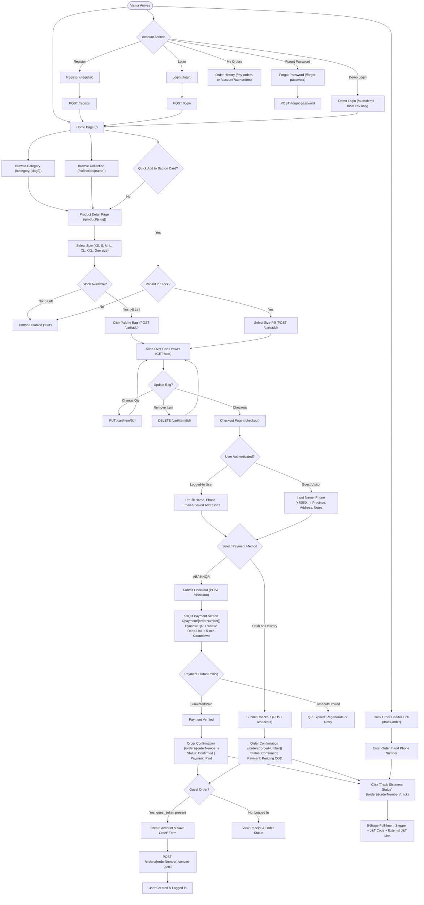
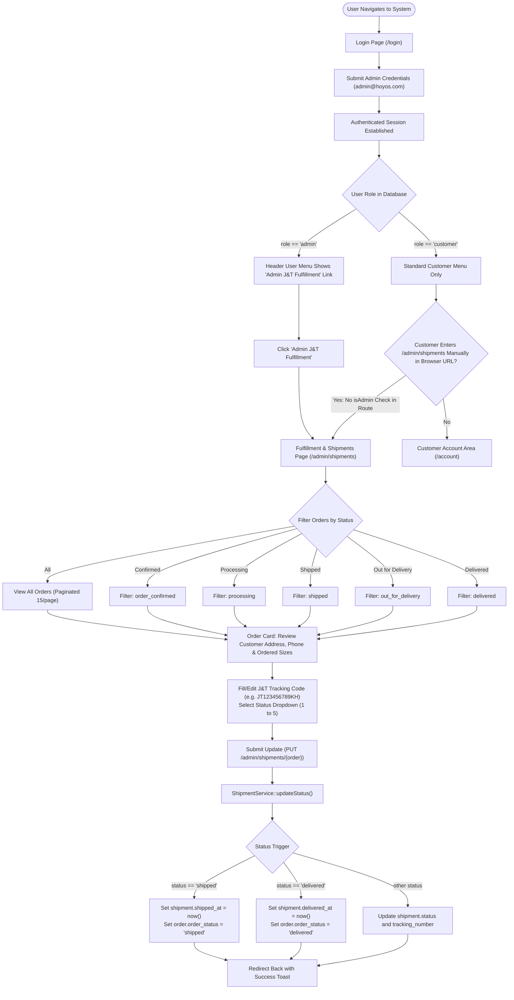

# HOYOS: End-to-End User Flows & System Architecture

This document describes the exact user flows implemented in the HOYOS codebase based on [`routes/web.php`](file:///d:/Hoyos-project/routes/web.php), [`routes/auth.php`](file:///d:/Hoyos-project/routes/auth.php), controllers, models, and Blade views.

---

## A. CUSTOMER FLOW (Guest and Logged-In)

### 1. Customer Flow Diagram

### 2. Numbered Step List

1. **Discovery & Browsing**
   - **Route:** `GET /` (`home`), `GET /category/{categorySlug?}` (`category.show`), `GET /products` (`products.index`), `GET /collection/{name}` (`products.collection`)
   - **Page:** `home.blade.php`, `products/index.blade.php`, `products/collection.blade.php`
   - **Roles/Permissions:** Public (Guest or Authenticated Customer/Admin)
   - **Behavior:** Customers browse hero showcases, curated aesthetic tabs (Y2K, GOTH, STREETWEAR), lookbooks, and collection grids with real-time prices and rating badges.

2. **Product Page & Sizing Selection**
   - **Route:** `GET /product/{slug}` (`products.show`)
   - **Page:** `products/show.blade.php`
   - **Roles/Permissions:** Public (Guest or Authenticated Customer/Admin)
   - **Behavior:** Multi-angle image gallery (front, detail, full), sizing chart (XS to XXL and One size with kg recommendations), and live stock counts per variant.
   - **Decision Point (Stock):** If a variant has `stock_quantity > 0`, it can be selected and added. If `stock_quantity == 0`, the pill displays "Out" and cannot be added.

3. **Add to Bag & Slide-Over Mini-Cart**
   - **Route:** `POST /cart/add` (`cart.add`), `GET /cart` (`cart.index`), `PUT /cart/item/{itemId}` (`cart.update`), `DELETE /cart/item/{itemId}` (`cart.remove`)
   - **Component/Page:** `components/cart-drawer.blade.php`
   - **Roles/Permissions:** Public (Guest or Authenticated). Carts are tied to session ID for guests and merged/linked to user ID upon authentication.
   - **Behavior:** Clicking "Add to bag" on PDP or selecting a quick-size pill on a product card fires an AJAX request, opening the slide-over drawer with item previews, sizes, quantity counters, and subtotal.

4. **Checkout (Delivery & Payment Selection)**
   - **Route:** `GET /checkout` (`checkout.index`), `POST /checkout` (`checkout.store`)
   - **Page:** `checkout/index.blade.php`
   - **Roles/Permissions:** Public (Guest or Authenticated). Empty carts redirect back to `/` with an info notice.
   - **Decision Point (Auth Status):**
     - *Logged-in user:* Pre-fills name, phone, email, and renders saved delivery addresses from `$user->addresses`. Can select a default address or enter a new one with a "Save address" checkbox.
     - *Guest visitor:* Enters recipient name, phone (`+855` or `0...` validated by regex), optional email, province (selected from Cambodia's 25 provinces dropdown), street address, and delivery notes.
   - **Decision Point (Payment Method):**
     - *Cash on Delivery (COD):* Order is stored with `payment_method = 'cod'`, `payment_status = 'pending'`, and immediately redirects to `/orders/{orderNumber}`.
     - *ABA KHQR:* Order is stored with `payment_method = 'aba_khqr'`, `payment_status = 'pending'`, and redirects to `/payment/{orderNumber}?token={guest_token}`.

5. **ABA KHQR Payment & Verification**
   - **Route:** `GET /payment/{orderNumber}` (`payment.show`), `GET /payment/{orderNumber}/status` (`payment.status`), `POST /payment/{orderNumber}/simulate` (`payment.simulate`)
   - **Page:** `payment/khqr.blade.php`
   - **Roles/Permissions:** Authorized guest (via session token or URL `token` parameter) OR authenticated order owner OR admin.
   - **Behavior:** Renders genuine EMVCo Bakong KHQR, merchant details ("HOYOS CLOTHING CO.,LTD"), 5-minute countdown timer, and `aba://pay?...` mobile deep-link. The frontend polls `/payment/{orderNumber}/status` every 3 seconds.
   - **Decision Point (Payment Verification):**
     - *Success / Paid:* Order status updates to `confirmed`, `payment_status` becomes `paid`, and page auto-redirects to `/orders/{orderNumber}`.
     - *Expired:* When timer reaches 0, polling halts, and user is shown an expired notice.

6. **Order Confirmation & Guest Account Conversion**
   - **Route:** `GET /orders/{orderNumber}` (`orders.show`), `POST /orders/{orderNumber}/convert-guest` (`orders.convert-guest`)
   - **Page:** `orders/show.blade.php`
   - **Roles/Permissions:** Authorized guest (with token) OR authenticated order owner OR admin.
   - **Behavior:** Shows success hero badge, copyable order number, itemized garment list, payment/order summary, and carrier status banner.
   - **Decision Point (Guest Account Creation):** If the order was placed as a guest (`user_id` is null), a 1-click account creation form is presented. Submitting a password creates a new `User` record, links the order to the account, and automatically logs the customer in.

7. **Track Order (Public Lookup & Shipment Stepper)**
   - **Route:** `GET|POST /track-order` (`orders.lookup`), `GET /orders/{orderNumber}/track` (`orders.track`)
   - **Page:** `orders/lookup.blade.php`, `orders/track.blade.php`
   - **Roles/Permissions:** Public lookup via Order # + Customer Phone. Full tracking view requires valid guest token, owner auth, or admin auth.
   - **Behavior:** Renders delivery carrier (J&T Express), copyable tracking code (e.g. `JT123456789KH`), button to external J&T tracking website, and internal 5-stage fulfillment stepper (`Order Confirmed` -> `Processing` -> `Shipped` -> `Out for Delivery` -> `Delivered`).

8. **Order History & Account Hub**
   - **Route:** `GET /my-orders` (`orders.index`), `GET /account` (`account.index`), `PUT /account/profile` (`account.profile.update`), `PUT /account/password` (`account.password.update`), `POST /account/address` (`account.address.store`), `DELETE /account/address/{address}` (`account.address.destroy`)
   - **Page:** `orders/index.blade.php`, `account/index.blade.php`
   - **Roles/Permissions:** Authenticated users only (`auth` middleware). Guests are redirected to `/login`.
   - **Behavior:** Customers view paginated history of past orders with tracking CTAs, edit personal details (name, email, phone, date of birth), change password, and manage delivery address book.

9. **Authentication, Demo Login & Password Reset**
   - **Route:** `GET /login` (`login`), `POST /login`, `GET /register` (`register`), `POST /register`, `GET /auth/demo` (`auth.demo`), `GET /forgot-password` (`password.request`), `POST /forgot-password`, `GET /reset-password/{token}` (`password.reset`), `POST /reset-password`, `POST /logout` (`logout`)
   - **Page:** `auth/login.blade.php`, `auth/register.blade.php`, `auth/forgot-password.blade.php`, `auth/reset-password.blade.php`
   - **Roles/Permissions:** `guest` middleware for login/register/forgot-password; `auth` middleware for logout.
   - **Behavior:** Dark input styling with red glow, autofill overrides, password visibility toggle. In `local` environment, "Continue with demo account" (`/auth/demo`) automatically logs in as `customer@hoyos.com`.

---

## B. ADMIN FLOW (What Exists in Code)

### 1. Admin Flow Diagram

### 2. Numbered Step List (Strictly What Exists in Code)

1. **Admin Authentication**
   - **Route:** `GET /login` (`login`), `POST /login`
   - **Page:** `auth/login.blade.php`
   - **Roles/Permissions:** `guest` middleware.
   - **Behavior:** There is no distinct admin login route (e.g. no `/admin/login`). Administrators log in using standard credentials (`admin@hoyos.com` seeded with password `password`).

2. **Access Control & Navigation**
   - **Role Definition:** The `users` table contains a `role` string column (`customer` by default, `admin` for administrators).
   - **Helper Method:** `User::isAdmin(): bool` returns `$this->role === 'admin'`.
   - **UI Navigation:** In [`resources/views/components/header.blade.php`](file:///d:/Hoyos-project/resources/views/components/header.blade.php), the profile dropdown conditionally displays the link `@if(Auth::user()->isAdmin())`:
     - Text: *"Admin J&T Fulfillment"*
     - Destination: `route('admin.shipments.index')` (`/admin/shipments`)

3. **Admin Dashboard**
   - **Route:** *None exists in code.*
   - **Behavior:** The application does not contain an admin dashboard controller, metrics screen, or `/admin/dashboard` route. Visiting `/dashboard` executes a closure in `routes/web.php` that redirects to `/account` (the customer account hub).

4. **Order and Shipment Management (J&T Tracking & Statuses)**
   - **Route:** `GET /admin/shipments` (`admin.shipments.index`)
   - **Page:** `admin/shipments/index.blade.php`
   - **Controller:** `App\Http\Controllers\Admin\ShipmentController::index()`
   - **Roles/Permissions:** Protected by `Route::middleware('auth')`. *(See Gaps: missing admin role gate).*
   - **Behavior:**
     - Displays orders paginated (15 per page) with customer name, phone, province, full street address, delivery notes, payment status (`paid` vs `pending`), and ordered items with size badges.
     - Filter pills at top: `All Orders`, `Confirmed`, `Processing`, `Shipped`, `Out for Delivery`, `Delivered`.
   - **Route:** `PUT /admin/shipments/{order}` (`admin.shipments.update`)
   - **Controller:** `App\Http\Controllers\Admin\ShipmentController::update()`
   - **Roles/Permissions:** Protected by `Route::middleware('auth')`.
   - **Behavior:**
     - Validates `tracking_number` (string, max 50, nullable) and `status` (`in:order_confirmed,processing,shipped,out_for_delivery,delivered`).
     - Associates or updates the `Shipment` record with `carrier = 'J&T Express'` and the entered tracking code.
     - Calls `ShipmentService::updateStatus()`:
       - Transitioning to `shipped` automatically stamps `shipped_at = now()` and syncs parent `order.order_status = 'shipped'`.
       - Transitioning to `delivered` stamps `delivered_at = now()` and syncs parent `order.order_status = 'delivered'`.
     - Returns back with success flash session message.

5. **Product and Inventory Management**
   - **Status in Code:** **DOES NOT EXIST.**
   - There are zero admin routes, controllers, or Blade templates for creating, editing, publishing, deleting products, or adjusting variant stock levels. Products and stock quantities currently exist exclusively through seeders (`DatabaseSeeder.php`), migrations, or database commands.

6. **User and Role Management**
   - **Status in Code:** **DOES NOT EXIST.**
   - There are zero admin routes, controllers, or Blade templates for viewing users, assigning roles, promoting admins, or managing customer accounts.

---

## Gaps

The following features, access controls, and screens are referenced, linked, or needed, but are missing or vulnerable in the codebase:

1. **Broken Access Control on Admin Area (`/admin/shipments`)**
   - **Finding:** In [`routes/web.php`](file:///d:/Hoyos-project/routes/web.php#L74), the admin group is protected only by `Route::middleware('auth')`. There is no `admin` middleware and no role check in `ShipmentController`.
   - **Impact:** Any registered customer who logs into their standard account and enters `http://127.0.0.1:8000/admin/shipments` directly into the browser URL bar can view all customer orders, phone numbers, delivery addresses, and change fulfillment statuses or tracking codes.

2. **Missing Admin Dashboard**
   - **Finding:** There is no admin overview or dashboard page. The default Laravel `/dashboard` route redirects to the customer hub (`/account`).

3. **Missing Admin Product & Inventory Management**
   - **Finding:** There is no product catalog management in the admin backoffice. Admins cannot add new products, edit descriptions, change prices, upload photos, or restock variant quantities through the UI.

4. **Missing Admin User & Role Management**
   - **Finding:** There is no UI to view registered users, deactivate accounts, or promote a customer to an administrator. Role changes require direct database manipulation or running seeders.

5. **Missing Wishlist / Favorites**
   - **Finding:** No database schema, routes, or controllers exist for wishlists or saving favorite items.

6. **Missing Customer Review Submission**
   - **Finding:** Product review counts and ratings are static columns on the `products` table. Customers cannot submit written reviews or star ratings through any form or endpoint.

7. **Direct J&T Courier API / Telemetry Integration**
   - **Finding:** There is no live webhook or API link to J&T Express Cambodia. Dispatchers must manually copy tracking numbers from paper/counter receipts into the admin form, and customers must click an external link to check carrier transit scans.

8. **Live ABA PayWay Webhook Receiver**
   - **Finding:** Payment verification relies on client-side simulation (`/payment/{orderNumber}/simulate`) and polling. A production ABA Bank server-to-server webhook callback route is not implemented.

9. **Direct `/cart` URL Handling**
   - **Finding:** Navigating directly to `GET /cart` in a browser does not show a full cart page; it immediately redirects to `/checkout` (or returns JSON if requested via API).
