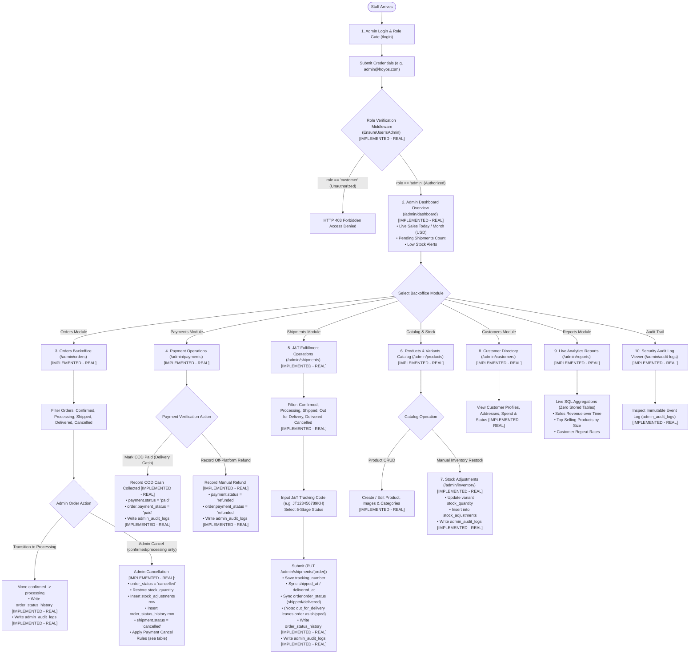

# HOYOS: Complete System User Flows (Customer & Admin)

> **Architecture:** Laravel 11, PostgreSQL 16+  
> **Source of Truth:** Codebase routes ([`routes/web.php`](file:///d:/Hoyos-project/routes/web.php), [`routes/auth.php`](file:///d:/Hoyos-project/routes/auth.php)), controllers, models, actions, Blade views, and approved architectural specifications.  
> **Traceability:** Every step documents the exact screen/route, actor, tables read/written, and implementation status (`[IMPLEMENTED - REAL]`, `[IMPLEMENTED - SIMULATED]`, or `[PLANNED - Phase 2]`).

---

## A. CUSTOMER STOREFRONT FLOW

### 1. Customer Flowchart (Mermaid)

```mermaid
flowchart TD
    Start([Visitor Enters Store]) --> Step1["1. Browse Catalog (/ or /products or /category/{slug} or /collection/{name})"]
    
    Step1 --> FilterCat["Filter by Category or Curated Collection"]
    FilterCat --> Step2["2. View Product Details (/product/{slug})"]
    
    Step2 --> SizeSelect["Select Apparel Size (XS to XXL, One size)"]
    SizeSelect --> StockCheck{"Stock Available?<br/>(stock_quantity > 0)"}
    
    StockCheck -->|"No (0 Units Left)"| DisabledBtn["Size Pill Shows 'Out' / Add Disabled"]
    StockCheck -->|"Yes (In Stock)"| Step3["3. Add to Bag & Open Drawer (/cart)"]
    
    Step3 --> CartDrawer["Slide-Over Cart Drawer (/cart)"]
    CartDrawer --> EditBag{"Modify Bag Items?"}
    EditBag -->|"Change Quantity"| PutCart["PUT /cart/item/{id}"] --> CartDrawer
    EditBag -->|"Remove Item"| DelCart["DELETE /cart/item/{id}"] --> CartDrawer
    EditBag -->|"Proceed to Checkout"| Step4["4. Checkout Page (/checkout)"]
    
    Step4 --> UserType{"Authenticated User?"}
    UserType -->|"Authenticated Customer (Logged-In)"| AuthCheckout["Pre-populate Name, Phone, Email & Saved Addresses"]
    UserType -->|"Guest Customer (Anonymous)"| GuestCheckout["Enter Contact & Delivery Address (Name, Phone, Province, Address)"]
    
    AuthCheckout --> Step5["5. Select Payment Method & Place Order (POST /checkout)"]
    GuestCheckout --> Step5
    
    Step5 --> PaymentChoice{"Select Payment Method"}
    PaymentChoice -->|"Cash on Delivery (COD)"| SubmitCOD["Create Order, Shipment & Pending COD Payment<br/>• Reserve Stock (Deduct)<br/>• payment_status = 'pending'"]
    PaymentChoice -->|"ABA KHQR (Dynamic QR)"| SubmitKHQR["Create Order, Shipment & Initialize KHQR<br/>• Reserve Stock (Deduct)<br/>• payment_status = 'pending'"]
    
    SubmitCOD --> Step9["9. Order Confirmation Screen (/orders/{orderNumber})<br/>Status: Confirmed | Payment: Pending COD"]
    
    SubmitKHQR --> Step6["6. ABA KHQR Screen (/payment/{orderNumber})<br/>• Dynamic EMVCo QR String<br/>• Mobile 'aba://' Deep-link<br/>• 5-Minute Expiry Countdown"]
    
    Step6 --> Step7{"7. Poll Status (/payment/{orderNumber}/status)<br/>or Sandbox Simulate (/simulate)"}
    Step7 -->|"Payment Verified (Paid)"| PaySuccess["payment.status = 'paid'<br/>order.payment_status = 'paid'"] --> Step9
    Step7 -->|"5-min Elapsed (No Payment)"| Step8["8. Payment Expiry & 15-Minute Grace Period"]
    
    Step8 --> GraceState["Order remains order_status = 'confirmed'<br/>payment_status = 'expired'<br/>Stock remains reserved (15-min grace window)"]
    GraceState --> RetryChoice{"Customer Action within 15 Minutes"}
    
    RetryChoice -->|"Retry Payment (Before Grace Expires)"| NewQR["Generate Fresh KHQR Attempt (1..N Payments) [IMPLEMENTED - REAL]<br/>• Check order still 'confirmed'<br/>• Create new payments row<br/>• Restart 5-Minute Timer"] --> Step6
    
    RetryChoice -->|"No Retry (15-min Grace Elapses)"| ExpiryCancel["Scheduled Command Auto-Cancellation [IMPLEMENTED - REAL]:<br/>• order_status = 'cancelled'<br/>• payment_status = 'expired'<br/>• Restore stock_quantity (once)<br/>• Insert stock_adjustments row<br/>• Insert order_status_history row<br/>• shipment.status = 'cancelled'"] --> CancelledState([Order Cancelled / Expired])
    
    Step9 --> CheckGuest{"Is Order from Guest?"}
    CheckGuest -->|"Guest Order (guest_token Present)"| Step10["10. Guest Account Conversion Form<br/>(Enter Password to save account)"]
    CheckGuest -->|"Logged-In (user_id Present)"| ViewOrderHist["View in Order History (/my-orders)"]
    
    Step10 --> PostConvert["Submit Conversion (POST /orders/{orderNumber}/convert-guest)<br/>• Create User Record<br/>• Link order.user_id<br/>• Set guest_token = NULL<br/>• Auto Login"] --> ViewOrderHist
    
    Step9 --> Step11["11. Track Order (/orders/{orderNumber}/track)"]
    
    Start --> DirectTrack["Header: Track Order (/track-order)"]
    DirectTrack --> LookupForm["Enter Order # and Phone Number"] --> Step11
    
    Step11 --> StepperView["Fulfillment Stepper (5 Stages)<br/>• J&T Tracking Code<br/>• External J&T Express Web Tracking Link"]
    
    Start --> Step12["12. Customer Account Hub (/account)"]
    Step12 --> TabPersonal["Personal Profile & Password Update"]
    Step12 --> TabAddress["Saved Addresses Management (CRUD)"]
    Step12 --> TabOrders["Order History & Status Overview"]
```

---

### 2. Numbered Customer Step List

#### Step 1: Browse & Filter Products
- **Screen / Route:**
  - Home Showcase: `GET /` (`route('home')`)
  - Products Catalog: `GET /products` (`route('products.index')`)
  - Category Filter: `GET /category/{categorySlug?}` (`route('category.show')`)
  - Curated Collection: `GET /collection/{name}` (`route('products.collection')`)
- **Actor:** Customer (Guest or Authenticated).
- **Tables Read:** `categories`, `products`, `product_variants`, `product_images`.
- **Tables Written:** None.
- **Status:** `[IMPLEMENTED - REAL]`.
- **Details:** Visitors browse curated hero showcases, aesthetics (Y2K, Goth, Streetwear), and filter active items (`is_active = true`, `deleted_at IS NULL`). Real prices, compare prices, and ratings are loaded directly from PostgreSQL.

#### Step 2: Product Detail & Size Choice
- **Screen / Route:** `GET /product/{slug}` (`route('products.show')`).
- **Actor:** Customer.
- **Tables Read:** `products`, `categories`, `product_variants`, `product_images`.
- **Tables Written:** None.
- **Status:** `[IMPLEMENTED - REAL]`.
- **Details:** Displays image gallery, sizing chart (height/weight guide), and variant pills (`XS`, `S`, `M`, `L`, `XL`, `XXL`, `One size`). If `stock_quantity == 0`, the button indicates "Out" and selection is disabled.

#### Step 3: Cart & Slide-Over Drawer
- **Screen / Route:**
  - Add Item: `POST /cart/add` (`route('cart.add')`)
  - Cart Endpoint: `GET /cart` (`route('cart.index')`)
  - Update Quantity: `PUT /cart/item/{itemId}` (`route('cart.update')`)
  - Remove Item: `DELETE /cart/item/{itemId}` (`route('cart.remove')`)
- **Actor:** Customer.
- **Tables Read:** `carts`, `cart_items`, `product_variants`, `products`, `product_images`.
- **Tables Written:** `carts`, `cart_items`.
- **Status:** `[IMPLEMENTED - REAL]`.
- **Details:** 
  - **`GET /cart` Behavior in Code:** In [`CartController::index()`](file:///d:/Hoyos-project/app/Http/Controllers/CartController.php#L15-L26), if requested with an AJAX/JSON header (`$request->wantsJson()`), it returns `{ success: true, cart: [...] }` to populate the slide-over drawer (`components/cart-drawer.blade.php`). If a user enters `/cart` directly into the browser address bar, it immediately executes `redirect()->route('checkout.index')`. There is no standalone full-page cart Blade view.
  - Carts are identified by `carts.session_id` for guests. When a customer logs in, `CartService::getCart()` merges anonymous guest cart items into the authenticated user's cart (`carts.user_id`).

#### Step 4: Checkout Initiation & Addresses
- **Screen / Route:** `GET /checkout` (`route('checkout.index')`).
- **Actor:** Customer (Guest or Authenticated).
- **Tables Read:** `carts`, `cart_items`, `product_variants`, `users`, `addresses`.
- **Tables Written:** None.
- **Status:** `[IMPLEMENTED - REAL]`.
- **Details:** If the cart is empty, redirects to home. Authenticated users have their profile information and saved addresses pre-loaded. Guests see inputs for recipient name, Cambodian telephone (`+855` / `0...`), province dropdown (all 25 Cambodian provinces hardcoded in `CheckoutController`), delivery street address, and delivery notes.

#### Step 5: Checkout Submission & Stock Reservation
- **Screen / Route:** `POST /checkout` (`route('checkout.store')`).
- **Actor:** Customer.
- **Tables Read:** `carts`, `cart_items`, `product_variants`.
- **Tables Written:** `orders`, `order_items`, `product_variants` (stock decremented), `shipments`, `payments`, `cart_items` (emptied), `addresses` (optionally saved for logged-in user).
- **Status:** `[IMPLEMENTED - REAL]`.
- **Details:** Executed inside a strict database transaction (`DB::transaction` in `CreateOrderAction`):
  1. `orders` record is created (`order_status = 'confirmed'`, `payment_status = 'pending'`).
  2. For each cart item, `product_variants.stock_quantity` is decremented immediately, and `order_items` snapshots `product_name`, `variant_size`, and `unit_price`.
  3. `shipments` record is created (`carrier = 'J&T Express'`, `status = 'order_confirmed'`).
  4. `payments` record is initialized.
  5. If guest, `orders.guest_token` (40-char string) is stored in session (`guest_order_token_{orderNumber}`).
  6. Cart items are cleared.

#### Step 6: Payment Execution (ABA KHQR vs COD)
- **Screen / Route:**
  - ABA KHQR View: `GET /payment/{orderNumber}` (`route('payment.show')`)
  - Cash on Delivery: Redirects directly to `GET /orders/{orderNumber}` (`route('orders.show')`)
- **Actor:** Customer.
- **Tables Read:** `orders`, `payments`.
- **Tables Written:** `payments` (created or updated with dynamic EMVCo KHQR string, transaction ID, 5-minute `expires_at`).
- **Status:**
  - Cash on Delivery (COD): `[IMPLEMENTED - REAL]`. Works 100% end-to-end without external payment gateway.
  - ABA KHQR Local Synthesis: `[IMPLEMENTED - SIMULATED]`. Generates EMVCo Bakong standard payload string locally using merchant ID `000129384` and `hoyos@ababank`, with deep link `aba://pay?...`.
  - Live ABA PayWay API Call: `[PLANNED - Phase 2]`.

#### Step 7: Payment Status Polling & Verification
- **Screen / Route:**
  - Status Polling: `GET /payment/{orderNumber}/status` (`route('payment.status')`)
  - Sandbox Simulator: `POST /payment/{orderNumber}/simulate` (`route('payment.simulate')`)
- **Actor:** Browser client (polling every 3 seconds) / Developer sandbox button.
- **Tables Read:** `orders`, `payments`.
- **Tables Written:** `payments` (`status = 'paid'`, `paid_at = now()`), `orders` (`payment_status = 'paid'`).
- **Status:**
  - Polling & Sandbox Simulator: `[IMPLEMENTED - SIMULATED]`.
  - Production Server-to-Server Webhook (`POST /api/webhooks/aba-payway`) with HMAC-SHA512 Signature Check *(proposed, confirm against ABA PayWay docs)*: `[PLANNED - Phase 2]`.
- **Details:** Polling checks local payment status. When simulated as paid, the client redirects to the Order Confirmation screen.

#### Step 8: Payment Expiry, 15-Minute Grace Period & Auto-Cancellation
- **Screen / Route:** `GET /payment/{orderNumber}/status`, `/payment/{orderNumber}`, and scheduled console command.
- **Actor:** Customer / Scheduled console command (`php artisan hoyos:check-payment-expiries`).
- **Tables Read:** `orders`, `payments`, `stock_adjustments`.
- **Tables Written:** `payments` (`status = 'expired'`), `orders` (`order_status = 'cancelled'`), `product_variants` (restore stock), `stock_adjustments`, `order_status_history`, `shipments` (`status = 'cancelled'`).
- **Status:** `[IMPLEMENTED - REAL]` *(Both active browser status check expiry and scheduled background auto-cancellation via `ExpireUnpaidOrdersCommand` are implemented)*.
- **Details & Two-Stage Lifecycle Rule:**
  1. **Stage 1: 5-Minute KHQR Expiry & Grace Period:**
     - When `payments.expires_at` (5 minutes) elapses without payment, the payment record is marked `status = 'expired'`.
     - The parent order remains `orders.order_status = 'confirmed'` with `orders.payment_status = 'expired'`.
     - **The stock remains reserved for a grace period of 15 minutes** (to be confirmed with the team) to give the customer an opportunity to retry payment.
  2. **Stage 2A: Customer Retries Payment within Grace Period:**
     - Customer clicks "Retry Payment" on the payment page.
     - System re-verifies that the parent order is still active (`order_status === 'confirmed'`).
     - System generates a **new row in `payments`** (supporting `orders 1 -> many payments`), sets a new 5-minute `expires_at`, and generates a fresh dynamic QR string.
  3. **Stage 2B: 15-Minute Grace Period Elapses with No Retry (Auto-Cancellation):**
     - A scheduled Laravel console command running `everyMinute()` finds expired orders past the 15-minute grace period.
     - Updates `orders.order_status = 'cancelled'` (system-triggered, `admin_id = NULL`).
     - Sets `shipments.status = 'cancelled'` (parcel was never packed or dispatched).
     - **Restores stock once:** Verifies via composite index `(order_id, adjustment_type)` that `stock_adjustments` does not already have an entry for this order, increments `product_variants.stock_quantity`, and logs to `stock_adjustments` (`adjustment_type = 'payment_expired'`).
     - Inserts a transition row into `order_status_history` (`old_status = 'confirmed'`, `new_status = 'cancelled'`, `admin_id = NULL`, `notes = 'System auto-cancellation: 15-minute KHQR payment grace period elapsed'`).

#### Step 9: Order Confirmation (Digital Receipt)
- **Screen / Route:** `GET /orders/{orderNumber}` (`route('orders.show')`).
- **Actor:** Customer.
- **Tables Read:** `orders`, `order_items`, `payments`, `shipments`, `product_variants`, `products`, `product_images`.
- **Tables Written:** None.
- **Status:** `[IMPLEMENTED - REAL]`.
- **Details:** Verified by `Order::canAccess($user, $token)`. Shows full breakdown: order number, payment confirmation, delivery address, ordered items with size pills, subtotal, and link to track shipment.

#### Step 10: Guest-to-Account Conversion
- **Screen / Route:** `POST /orders/{orderNumber}/convert-guest` (`route('orders.convert-guest')`).
- **Actor:** Guest customer.
- **Tables Read:** `orders`, `users`.
- **Tables Written:** `users` (new customer created), `orders` (`user_id = users.id`, `guest_token = null`).
- **Status:** `[IMPLEMENTED - REAL]`.
- **Details:** Guest inputs a password. System creates the `users` record using the customer's email and phone, associates the order, clears `guest_token`, logs the user in, and refreshes the confirmation page.

#### Step 11: Order Tracking Lookup & 5-Stage Stepper
- **Screen / Route:**
  - Lookup Form: `GET|POST /track-order` (`route('orders.lookup')`)
  - Stepper Screen: `GET /orders/{orderNumber}/track` (`route('orders.track')`)
- **Actor:** Customer (Guest or Authenticated).
- **Tables Read:** `orders`, `shipments`, `order_items`.
- **Tables Written:** None (Guest token persisted in session on valid phone/order lookup).
- **Status:** `[IMPLEMENTED - REAL]`.
- **Details:** Visual 5-stage fulfillment tracker (`order_confirmed` → `processing` → `shipped` → `out_for_delivery` → `delivered`). If J&T tracking code exists, displays external tracking button linking to official `https://www.jtexpress.com.kh/tracking?billcode=...`.

#### Step 12: Customer Account Hub & Order History
- **Screen / Route:**
  - Hub Dashboard: `GET /account` (`route('account.index')`)
  - Order History: `GET /my-orders` (`route('orders.index')`)
  - Update Profile: `PUT /account/profile` (`route('account.profile.update')`)
  - Update Password: `PUT /account/password` (`route('account.password.update')`)
  - Save Address: `POST /account/address` (`route('account.address.store')`)
  - Delete Address: `DELETE /account/address/{address}` (`route('account.address.destroy')`)
- **Actor:** Authenticated Customer (`role = 'customer'`).
- **Tables Read:** `users`, `addresses`, `orders`, `order_items`, `shipments`, `payments`.
- **Tables Written:** `users`, `addresses`.
- **Status:** `[IMPLEMENTED - REAL]`.
- **Details:** Central tabbed customer management portal. Allows updating name, DOB, phone, managing multiple addresses with a default flag, and viewing historical orders.

---

## B. ADMIN DASHBOARD & BACKOFFICE FLOW

### 1. Admin Flowchart (Mermaid)

---

### 2. Numbered Admin Step List

#### Step 1: Admin Authentication & Role Authorization Gate
- **Screen / Route:**
  - Login Page: `GET /login` (`route('login')`), `POST /login`
  - Admin Role Gate: `EnsureUserIsAdmin` middleware on `Route::prefix('admin')`
- **Actor:** Administrator (`users.role = 'admin'`).
- **Tables Read:** `users`.
- **Tables Written:** `sessions`.
- **Status:**
  - Authentication: `[IMPLEMENTED - REAL]`.
  - Role Gate (`EnsureUserIsAdmin`): `[IMPLEMENTED - REAL]`.
- **Details:** If authenticated user has `role !== 'admin'`, the middleware immediately returns `403 Forbidden`. Only authorized administrators proceed to the `/admin` prefix.

#### Step 2: Dashboard Overview & Real-Time KPIs
- **Screen / Route:** `GET /admin/dashboard` (`route('admin.dashboard')`).
- **Actor:** Administrator.
- **Tables Read:** `orders`, `payments`, `shipments`, `product_variants`, `users` (live SQL queries).
- **Tables Written:** None.
- **Status:** `[IMPLEMENTED - REAL]`.
- **Details:** Displays real-time sales metrics (today, this week, this month), orders needing fulfillment, shipments currently in transit via J&T Express, and low-inventory warnings (`stock_quantity < 5`).

#### Step 3: Orders Backoffice, Status Transitions & Admin Cancellation
- **Screen / Route:**
  - List Orders: `GET /admin/orders` (`route('admin.orders.index')`)
  - Order Details: `GET /admin/orders/{order}` (`route('admin.orders.show')`)
  - Transition Status: `PUT /admin/orders/{order}/status` (`route('admin.orders.status')`)
  - Cancel Order: `POST /admin/orders/{order}/cancel` (`route('admin.orders.cancel')`)
- **Actor:** Administrator.
- **Tables Read:** `orders`, `order_items`, `payments`, `shipments`, `product_variants`, `users`, `stock_adjustments`.
- **Tables Written:** `orders` (`order_status`), `order_status_history`, `product_variants` (restore stock), `stock_adjustments`, `shipments` (`status = 'cancelled'`), `admin_audit_logs`.
- **Status:** `[IMPLEMENTED - REAL]`.
- **Details & State Transition Matrix:**
  - **Single Source of Truth for Statuses:**
    - The **Orders screen** handles:
      - `confirmed` ➔ `processing` (warehouse team begins packing).
      - Admin cancellation (allowed **ONLY** when `order_status` is `confirmed` or `processing`).
    - The **Shipments screen** handles:
      - `processing` ➔ `shipped` (goods handed to courier).
      - `shipped` ➔ `out_for_delivery` (rider out; `orders.order_status` remains `shipped`).
      - `out_for_delivery` ➔ `delivered` (recipient received goods; `orders.order_status` becomes `delivered`).
      - *Orders cannot transition directly to `shipped` or `delivered` from the Orders screen.*
  - **Cancellation Rules by Payment Method:**
    Orders in `shipped` or `delivered` status **CANNOT be cancelled**. For orders in `confirmed` or `processing`, cancellation behaves as follows:

| Payment Method & State at Cancel | `orders.order_status` | `orders.payment_status` | `payments.status` | Stock & Shipments Action | Financial Action |
| :--- | :--- | :--- | :--- | :--- | :--- |
| **Cash on Delivery (COD)** | `cancelled` | `cancelled` | `cancelled` | Stock restored to variants (`stock_adjustments` row logged); `shipments.status = 'cancelled'`. | No financial transaction took place; zero refund needed. |
| **Paid ABA KHQR** | `cancelled` | `refunded` | `refunded` | Stock restored to variants (`stock_adjustments` row logged); `shipments.status = 'cancelled'`. | Management issues off-platform manual bank refund, then records status as `refunded`. |
| **Unpaid KHQR (within 15-min grace)** | `cancelled` | `expired` | `expired` | Stock restored to variants (`stock_adjustments` row logged); `shipments.status = 'cancelled'`. | No funds collected; no refund needed. |

#### Step 4: Payments Management & COD Cash Collection
- **Screen / Route:**
  - Payments List: `GET /admin/payments` (`route('admin.payments.index')`)
  - Mark COD as Paid: `POST /admin/payments/{payment}/mark-paid` (`route('admin.payments.mark-paid')`)
  - Record Refund: `POST /admin/payments/{payment}/refund` (`route('admin.payments.refund')`)
- **Actor:** Administrator.
- **Tables Read:** `payments`, `orders`.
- **Tables Written:** `payments` (`status`, `paid_at`), `orders` (`payment_status`), `admin_audit_logs`.
- **Status:** `[IMPLEMENTED - REAL]`.
- **Details:**
  - When J&T Express delivers a COD package and remits cash to Hoyos, the admin clicks "Mark COD as Paid" (`payments.status = 'paid'`, `orders.payment_status = 'paid'`, `paid_at = now()`). Works 100% without an external gateway.
  - If management authorizes an off-platform manual refund, the admin records `payments.status = 'refunded'` and `orders.payment_status = 'refunded'`.

#### Step 5: Shipment & J&T Tracking Code Management
- **Screen / Route:**
  - Shipments Queue: `GET /admin/shipments` (`route('admin.shipments.index')`)
  - Update Shipment: `PUT /admin/shipments/{order}` (`route('admin.shipments.update')`)
- **Actor:** Administrator / Dispatcher.
- **Tables Read:** `orders`, `shipments`, `payments`, `order_items`, `product_variants`, `products`.
- **Tables Written:** `shipments` (`tracking_number`, `status`, `shipped_at`, `delivered_at`), `orders` (`order_status`), `order_status_history`, `admin_audit_logs`.
- **Status:** `[IMPLEMENTED - REAL]`.
- **Details:** 
  - Admin inputs the physical J&T Express tracking number (e.g. `JT123456789KH`) and updates fulfillment stage.
  - Filter pills at top: `All Orders`, `Confirmed`, `Processing`, `Shipped`, `Out for Delivery`, `Delivered`, and `Cancelled`.
  - `ShipmentService::updateStatus()` automatically stamps `shipped_at = now()` when transitioning to `shipped` and `delivered_at = now()` when transitioning to `delivered`, syncing the parent `order.order_status`.
  - Transitioning to `out_for_delivery` leaves `order.order_status` as `'shipped'`.
  - `ShipmentService` writes entries to `order_status_history` and `admin_audit_logs`.

#### Step 6: Product, Variant & Gallery Catalog Management
- **Screen / Route:**
  - Catalog Index: `GET /admin/products` (`route('admin.products.index')`)
  - Create Product: `POST /admin/products` (`route('admin.products.store')`)
  - Update Product: `PUT /admin/products/{product}` (`route('admin.products.update')`)
  - Manage Gallery: `POST /admin/products/{product}/images` (`route('admin.products.images')`)
  - Delete (Soft): `DELETE /admin/products/{product}` (`route('admin.products.destroy')`)
- **Actor:** Administrator.
- **Tables Read:** `products`, `categories`, `product_variants`, `product_images`.
- **Tables Written:** `products`, `product_variants`, `product_images`, `admin_audit_logs`.
- **Status:** `[IMPLEMENTED - REAL]`.
- **Details:** Manage product titles, descriptions, sizing charts, collection tags (Y2K, Goth, Streetwear), base pricing, and upload photo gallery assets with primary flags and credits.

#### Step 7: Inventory Management & Stock Adjustments
- **Screen / Route:**
  - Inventory Overview: `GET /admin/inventory` (`route('admin.inventory.index')`)
  - Adjust Stock: `POST /admin/inventory/adjust` (`route('admin.inventory.adjust')`)
- **Actor:** Administrator / Warehouse Staff.
- **Tables Read:** `product_variants`, `products`, `stock_adjustments`.
- **Tables Written:** `product_variants` (`stock_quantity`), `stock_adjustments`, `admin_audit_logs`.
- **Status:** `[IMPLEMENTED - REAL]`.
- **Details:** Admin inspects SKU inventory per size variant. Staff can record warehouse shipments (`adjustment_type = 'manual_restock'`), damage (`'damage'`), or inventory shrinkage (`'manual_shrinkage'`). Writes an immutable record to `stock_adjustments` with quantity before, delta, quantity after, and reason.

#### Step 8: Customer Directory
- **Screen / Route:**
  - Customers List: `GET /admin/customers` (`route('admin.customers.index')`)
  - Customer Profile: `GET /admin/customers/{user}` (`route('admin.customers.show')`)
- **Actor:** Administrator.
- **Tables Read:** `users`, `orders`, `addresses`.
- **Tables Written:** `users` (`account_status`), `admin_audit_logs`.
- **Status:** `[IMPLEMENTED - REAL]`.
- **Details:** View customer account profiles, registration date, telephone numbers, saved delivery addresses, order counts, lifetime customer expenditure, and toggle `account_status` (`active` vs `suspended`).

#### Step 9: Live Analytical Reports
- **Screen / Route:**
  - Sales Report: `GET /admin/reports/sales` (`route('admin.reports.sales')`)
  - Product Performance: `GET /admin/reports/products` (`route('admin.reports.products')`)
  - Customer Cohorts: `GET /admin/reports/customers` (`route('admin.reports.customers')`)
- **Actor:** Administrator / Store Owner.
- **Tables Read:** `orders`, `order_items`, `payments`, `product_variants`, `products`, `users` (live database queries).
- **Tables Written:** None *(Strict design decision: zero pre-aggregated report tables)*.
- **Status:** `[IMPLEMENTED - REAL]`.
- **Details:** Real-time SQL aggregations using PostgreSQL date truncations and sums. Calculates gross merchandise value (GMV), average order value (AOV), best-selling apparel sizes, and sales distribution across Cambodian provinces.

#### Step 10: Security & Backoffice Audit Trail
- **Screen / Route:** `GET /admin/audit-logs` (`route('admin.audit-logs.index')`).
- **Actor:** Administrator / Security Officer.
- **Tables Read:** `admin_audit_logs`, `users`.
- **Tables Written:** None.
- **Status:** `[IMPLEMENTED - REAL]`.
- **Details:** Searchable, immutable event log showing the admin ID, module, action verb, affected entity ID, before/after JSON diffs, client IP address, and timestamp.

---

### 3. What is Implemented vs Phase 2

| Subsystem / Capability | Current Status | Notes & Scope Boundaries |
| :--- | :--- | :--- |
| **Storefront & Catalog** | **Implemented** | Product browsing, category filtering, search, responsive design, shopping cart. |
| **Checkout & Guest Access** | **Implemented** | Dual payment options (KHQR + COD), guest token isolation, account conversion post-purchase. |
| **Order Management Lifecycle** | **Implemented** | `confirmed` ➔ `processing` ➔ `shipped` ➔ `delivered` / `cancelled`. Full state history logged in `order_status_history`. |
| **Payment Simulation & Polling** | **Implemented** | EMVCo KHQR generation, 5-minute countdown, 15-minute grace period with retry, scheduled auto-cancellation. |
| **Inventory Ledger** | **Implemented** | Atomic reserve & release, pessimistic locking, negative inventory check constraint, full `stock_adjustments` audit history. |
| **Admin Operations Suite** | **Implemented** | Dedicated `EnsureUserIsAdmin` protection, orders, payments, shipments, products CRUD, inventory restock, customer status toggle, audit logs viewer. |
| **Analytics & Reporting** | **Implemented** | Live SQL queries for sales, products, customer cohorts, and timezone-correct grouping on PostgreSQL. |
| **Loyalty & Rewards System** | **Phase 2 (Deferred)** | Points earning, tier progression, loyalty discounts. |
| **Content Management System (CMS)** | **Phase 2 (Deferred)** | Blog articles, promotional banner manager, marketing page builder. |
| **Production ABA PayWay Integration** | **Phase 2 (Deferred)** | Bank API keys, server-to-server webhook callback, HMAC-SHA512 verification. |
| **Automated Gateway Refunds** | **Phase 2 (Deferred)** | Bank API refund calls. Currently handled as off-platform manual refunds recorded in admin. |
